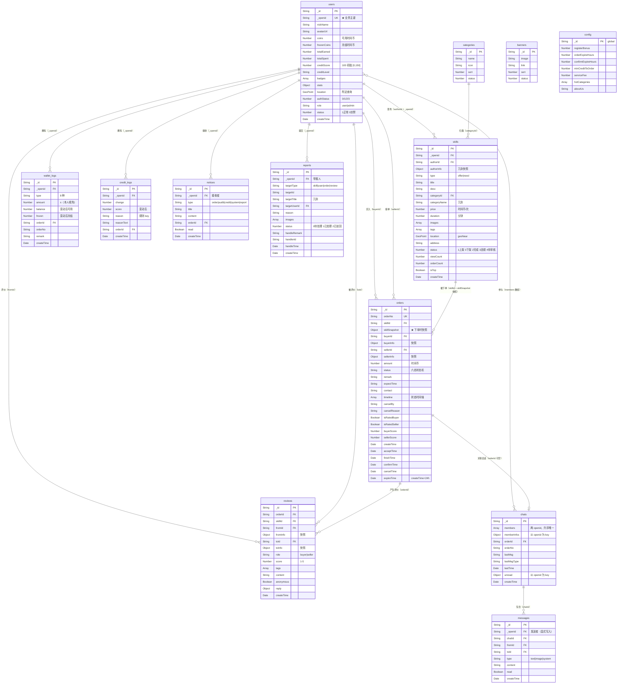

# 校园时间银行 · 数据库设计

> 最后更新：2026-06 | 适用版本：v1.0.0

本文档描述项目 **13 个云数据库集合**的完整设计。字段定义与
[ARCHITECTURE.md](ARCHITECTURE.md) §3 保持一致；集合名常量统一定义在
`cloudfunctions/_shared/index.js` 的 `C` 对象里，所有云函数只引用这个常量，不写字符串字面量。

**技术选型**：微信云开发数据库（MongoDB 文档型），无需自建服务器、无需连接池、无需 ORM。
它天然适合本项目 —— 校园互助的数据形态是「结构松散的文档 + 简单查询」，
用关系型数据库反而要写大量 JOIN，而这里用冗余快照 + 单集合查询就够了。

---

## 目录

1. [设计原则](#1-设计原则)
2. [13 张集合的详细表结构](#2-13-张集合的详细表结构)
3. [ER 关系图](#3-er-关系图)
4. [索引建议](#4-索引建议)
5. [数据字典（枚举汇总）](#5-数据字典枚举汇总)
6. [数据量估算与分页策略](#6-数据量估算与分页策略)

---

## 1. 设计原则

### 1.1 冗余快照换查询性能

云开发数据库**不支持跨集合 JOIN**（只能在同一个集合内做聚合 `lookup`，代价高且受 100 条
结果集限制）。因此凡是「列表页要展示、且内容不会频繁变化」的关联数据，
在写入时就**冗余存一份快照**：

| 快照字段 | 存在位置 | 快照内容 | 为什么 |
|---|---|---|---|
| `skills.authorInfo` | `skills` | 作者的昵称、头像、信用分、信用等级、认证状态 | 广场列表要显示发布者信息；若每页 10 条都去查 `users`，一次列表请求会变成 11 次数据库查询 |
| `orders.skillSnapshot` | `orders` | 下单时的标题、价格、时长、分类名、图片、类型 | 技能可能被改价、下架甚至删除；订单必须**永远**显示「当时买的是什么、花了多少」。这也是对交易双方的凭据保护 |
| `orders.buyerInfo` / `sellerInfo` | `orders` | 双方昵称、头像、信用分 | 订单列表、订单详情、聊天入口都要显示对方信息 |
| `chats.memberInfos` | `chats` | 以 openid 为 key 的成员昵称与头像 | 会话列表要显示对方头像与昵称 |
| `reviews.fromInfo` / `toInfo` | `reviews` | 评价人与被评价人的昵称、头像 | 评价列表展示 |
| `reports.targetTitle` | `reports` | 被举报对象的标题 | 管理端举报列表要看「举报的是什么」 |
| `skills.categoryName` | `skills` | 分类中文名 | 广场筛选与卡片标签直接显示，避免为分类名再查一次 |

**一致性怎么保证？** 快照是「**历史事实**」而非「当前状态」，刻意不追平：

- 用户改了昵称 → **新发布**的技能用新昵称，**旧**技能与**旧**订单保留旧昵称。
  这是电商系统的通行做法（订单是凭证，不能因为用户改名就篡改历史）。
- 技能被下架 → 订单里的 `skillSnapshot` 依然完整，买家仍能确认完成、仍能评价。
- 如果确实需要「当前昵称」，则查 `users`（详情页就是这么做的：`skill.detail` 同时返回
  `skill`（含快照）和 `author`（实时用户文档）两个字段）。

### 1.2 用 `_openid` 作业务主键

云开发会自动给每条文档加 `_id`（随机字符串）和 `_openid`（创建者的 openid）。
本项目的做法是：

- `_id` —— 只作为技术主键（内部引用、云函数 `doc(id)` 定位用）。
- `_openid` —— 作为**用户业务标识**，全库统一用 `_openid` 串联用户相关数据。

这样做的好处与代价：

| 好处 | 说明 |
|---|---|
| 免登录态查询用户 | 云函数里 `cloud.getWXContext().OPENID` 直接就是用户标识，不用先建用户表再查映射 |
| 天然幂等 | 一个 openid 对应唯一用户文档，登录逻辑可以「查不到就建」，不会重复注册 |
| 权限模型直接可用 | 云开发集合权限里的「仅创建者可写」就是基于 `_openid` 判定的 |

代价是**查询用户要按 `_openid` 而不是 `_id`**（所以 `getUser()` 用的是 `.where({ _openid })`
而非 `.doc()`）。云函数里先按 `_openid` 拿到用户文档，再用它的 `_id` 做后续 `doc().update()`：

```js
const u = await getUser(openid)                        // where({ _openid }).limit(1)
await db.collection(C.USERS).doc(u._id).update({ ... }) // document id
```

> **业务外键一览**：`skills.authorId` = `_openid`；`orders.buyerId` / `sellerId` = `_openid`；
> `reviews.fromId` / `toId` = `_openid`；`wallet_logs._openid` / `credit_logs._openid` = 用户；
> `notices._openid` = 接收者；`chats.members` = 两个 `_openid`。

### 1.3 时间币用流水记账

时间币**不是**只改一个余额字段就完事，而是「**改余额 + 写流水**」成对出现：

```
用户文档（当前状态）              流水集合（历史账本）
users.coins / frozenCoins   ←→   wallet_logs（每笔变动一条）
users.creditScore           ←→   credit_logs（每次变动一条）
```

为什么必须写流水：

1. **可审计**：`users.coins` 只能告诉你「现在有多少」，`wallet_logs` 才能回答
   「这 5 枚是怎么来的」。出现纠纷时管理员可以逐笔追溯。
2. **可对账**：平台时间币总量应恒等于 `Σ(users.coins + users.frozenCoins)`。
   拿 `wallet_logs` 的净额与用户余额汇总比对，任何一笔漏记都能立刻发现。
3. **用户可见**：钱包页明细、7 日收支趋势（`wallet.stats`）全部来自流水，不依赖用户文档。

**口径定义（三种余额）**：

| 口径 | 计算方式 | 含义 | 用在哪 |
|---|---|---|---|
| 可用余额 | `users.coins` | 现在能立刻花掉的 | 下单前校验 |
| 冻结额 | `users.frozenCoins` | 已下单但订单未完成，被锁住的 | 钱包页「冻结中」 |
| 总资产 | `coins + frozenCoins` | 账面上属于该用户的全部时间币 | 钱包页总额、平台流通量统计 |

**流水的 `amount` 符号约定**：对**本人视角**，正数 = 进账、负数 = 出账。

| 流水 type | amount 符号 | 何时产生 |
|---|---|---|
| `bonus` | `+registerBonus` | 首次登录自动注册 |
| `freeze` | `-price` | 下单 |
| `unfreeze` | `+price` | 拒单 / 取消 / 超时关闭 |
| `expense` | `-price` | 买家确认完成（真正扣除） |
| `income` | `+price` | 卖家收到结算 |
| `admin` | `±amount` | 管理员仲裁调整 |
| `settle` / `refund` | **从未写入**（语义与 `income` / `unfreeze` 重复） | 见 §5.4 |

> ⚠️ **一个需要注意的不一致点**：`freeze` 与 `expense` 是同一个买家的两笔负数流水
> （下单时 `-price`，完成时又一笔 `-price`），这意味着**按 `wallet_logs` 的 `amount` 求和
> 并不等于余额变化**。真实的余额口径是「`freeze` 是可用→冻结的搬运（总额不变），
> `expense` 才是真正的支出」。`wallet.stats` 在计算 7 日收支趋势时按
> `type in ['income','expense']` 过滤，正是为了避开这个重复计数。

### 1.4 集合权限与安全边界

14 个集合的权限分为两类（详见 [部署指南 §6](部署指南.md#6-集合权限配置表)）：

```
┌───────────────────────────────────────────────────────────────────┐
│  11 个集合：仅管理端可读写                                         │
│  users · categories · skills · orders · reviews ·                 │
│  wallet_logs · credit_logs · notices · reports · banners · config │
│                                                                   │
│  客户端完全无法直连 → 所有读写必须过云函数 → 云函数里做身份与状态校验  │
│  这是「金额字段不可被客户端篡改」的根本保障                          │
└───────────────────────────────────────────────────────────────────┘

┌───────────────────────────────────────────────────────────────────┐
│  2 个集合：所有用户可读，仅创建者可写                               │
│  chats · messages                                                 │
│                                                                   │
│  开放读 → 客户端 db.collection('messages').watch() 实时聊天才可用    │
│  限制写 → 发消息仍强制走 message.send 云函数（服务端校验会话成员）    │
└───────────────────────────────────────────────────────────────────┘
```

**云函数里的三道校验（`_shared/index.js`）**：

| 函数 | 作用 | 抛出的错误码 |
|---|---|---|
| `requireUser(openid)` | 用户必须存在且未被封禁（`status === 1`） | 401 / 403 |
| `requireVerified(openid)` | 用户必须已通过校园认证（`authStatus === 2`） | 403 |
| `requireAdmin(openid)` | 用户必须是管理员（`role === 'admin'`） | 403 |

`admin` 云函数**除 `check` 外的每一个 action** 开头都有 `await requireAdmin()`。

### 1.5 事务边界的设计原则

只有「涉及时间币金额变动」的操作才使用 `db.runTransaction`：

| 操作 | 是否用事务 | 事务内改写的文档 |
|---|---|---|
| 下单 `order.create` | ✅ | `users`（买家余额/冻结）+ `orders`（新增）+ `skills`（orderCount） |
| 关闭退款 `closeAndRefund`（拒单/取消/超时共用） | ✅ | `users`（买家余额/冻结）+ `orders`（状态/时间轴） |
| 结算 `settleOrder`（确认/超时自动确认共用） | ✅ | `users`（买家冻结）+ `users`（卖家余额）+ `orders`（状态/时间轴） |
| 写时间币流水 | ❌ 事务外补写 | `wallet_logs` |
| 写信用分流水 | ❌ 事务外补写 | `users`（creditScore）+ `credit_logs` |
| 发通知 / 订阅消息 | ❌ 事务外补写 | `notices` / 开放接口 |
| 补发徽章 | ❌ 事务外补写 | `users`（badges） |
| 浏览量自增 | ❌ 不用事务 | `skills`（`_.inc(1)`） |
| 接单 / 标记完成 | ❌ 用**条件更新**代替事务 | `orders`（`where({_id, status}).update()` 原子抢占） |

**为什么要划这条线？** 云开发单个事务有执行时长限制（默认较短），
参与事务的文档越多、越容易超时失败。而「写流水/通知/徽章」这些操作的特点是
**失败不影响主流程正确性**（钱已经对了，只是账本少记一笔），
所以统一用 `bestEffort(label, fn)` 包起来：出错只 `console.error` 记日志，
绝不把「已经成功的交易」变成客户端眼中的失败。

---

## 2. 13 张集合的详细表结构

> 类型说明：`String` / `Number` / `Boolean` / `Date`（云数据库的 Date 类型）/ `GeoPoint`
> （`db.Geo.Point(lng, lat)`）/ `[T]`（元素为 T 的数组）/ `{...}`（嵌套对象）。
> 「必填」指**业务上必须有值**；云数据库本身不做 schema 校验，靠云函数保证。

### 2.1 `users` — 用户

云函数 `login` 的 `login` action 首次调用时自动创建，字段由 `newUserDoc(openid, bonus)` 生成。

| 字段 | 类型 | 必填 | 说明 | 示例 |
|---|---|---|---|---|
| `_id` | String | ✅ | 文档 ID（云开发自动生成） | `"a1b2c3d4e5f6g7h8"` |
| `_openid` | String | ✅ | ★ 用户唯一标识，全库以此串联 | `"oX7aBcDeFgHiJkLmNoPqRsTuVwX"` |
| `nickName` | String | ✅ | 昵称 | `"张小明"` |
| `avatarUrl` | String | ○ | 头像（`cloud://` fileID 或 https） | `"cloud://env.xxx/avatar/1.png"` |
| `gender` | Number | ○ | 0 未知 / 1 男 / 2 女 | `1` |
| `phone` | String | ○ | 手机号（**隐私字段**，对外过滤） | `"13800138000"` |
| `campus` | String | ○ | 学校 | `"示范大学"` |
| `college` | String | ○ | 学院 | `"计算机学院"` |
| `major` | String | ○ | 专业 | `"软件工程"` |
| `grade` | String | ○ | 年级 | `"2022级"` |
| `realName` | String | ○ | ★ 真实姓名（校园认证时提交，管理端审核要核对） | `"张小明"` |
| `studentNo` | String | ○ | 学号（**隐私字段**） | `"20220001"` |
| `bio` | String | ○ | 个人简介 | `"喜欢弹吉他，也可以帮写高数作业"` |
| `tags` | [String] | ○ | 技能标签 | `["吉他","高数","摄影"]` |
| `authStatus` | Number | ✅ | 认证状态：0 未提交 1 待审核 2 已通过 3 已驳回 | `2` |
| `authImages` | [String] | ○ | 学生证/校园卡照片 fileID（**隐私字段**） | `["cloud://env.xxx/auth/1.jpg"]` |
| `authRemark` | String | ○ | 管理员驳回原因 | `"照片模糊，请重新上传"` |
| `authTime` | Date | ○ | 认证提交或通过时间 | `ISODate("2026-06-01T09:00:00Z")` |
| `coins` | Number | ✅ | ★ 可用时间币 | `12` |
| `frozenCoins` | Number | ✅ | ★ 冻结时间币 | `3` |
| `totalEarned` | Number | ✅ | 累计赚取 | `20` |
| `totalSpent` | Number | ✅ | 累计消耗 | `11` |
| `creditScore` | Number | ✅ | ★ 信用分，初始 100，范围 [0,150] | `112` |
| `creditLevel` | String | ✅ | 信用等级 key | `"good"` |
| `badges` | [String] | ✅ | 已获徽章 id 数组 | `["newbie","trust"]` |
| `stats` | Object | ✅ | 统计（冗余，列表展示用） | 见下 |
| `stats.publishCount` | Number | ○ | 发布数 | `3` |
| `stats.serveCount` | Number | ○ | 完成「提供技能」单数 | `6` |
| `stats.buyCount` | Number | ○ | 完成「购买服务」单数 | `2` |
| `stats.reviewCount` | Number | ○ | 收到评价数 | `5` |
| `stats.ratingSum` | Number | ○ | 评分总和（算平均用） | `23` |
| `stats.avgRating` | Number | ○ | 平均分，保留 1 位 | `4.6` |
| `stats.ontimeStreak` | Number | ○ | 连续按时完成单数 | `4` |
| `location` | GeoPoint | ○ | 最近一次定位（**附近的人/技能**） | `db.Geo.Point(113.93, 22.53)` |
| `locationName` | String | ○ | 位置描述 | `"东区宿舍"` |
| `locationTime` | Date | ○ | 定位上报时间 | `ISODate(...)` |
| `role` | String | ✅ | `'user'` \| `'admin'` | `"user"` |
| `status` | Number | ✅ | 1 正常 / 0 封禁 | `1` |
| `createTime` | Date | ✅ | 注册时间 | `ISODate(...)` |
| `updateTime` | Date | ✅ | 最近更新时间 | `ISODate(...)` |
| `lastLoginTime` | Date | ✅ | 最近登录时间 | `ISODate(...)` |

> 对外返回时用 `_shared` 的 `publicUser(u)` 过滤隐私字段。
> 黑名单常量 `PUBLIC_USER_BLACKLIST` 共 5 项：
> `phone`（手机号）/ `studentNo`（学号）/ `realName`（真实姓名）/
> `authImages`（认证照片）/ `authRemark`（驳回原因）。

### 2.2 `categories` — 技能分类

种子数据见 `cloudfunctions/initdb/index.js`，前端兜底副本见 `utils/constants.js` 的 `DEFAULT_CATEGORIES`（10 个分类：学业辅导 / 技能教学 / 摄影修图 / 代取代买 / 电脑技术 / 运动健身 / 生活服务 / 设计美工 / 语言互助 / 其他）。

| 字段 | 类型 | 必填 | 说明 | 示例 |
|---|---|---|---|---|
| `_id` | String | ✅ | 分类 ID | `"c1"` |
| `name` | String | ✅ | 分类名 | `"学业辅导"` |
| `icon` | String | ✅ | emoji 图标（项目零图片资源） | `"📚"` |
| `sort` | Number | ✅ | 排序权重，升序 | `1` |
| `status` | Number | ✅ | 1 启用 / 0 停用 | `1` |
| `createTime` | Date | ✅ | 创建时间 | `ISODate(...)` |

### 2.3 `skills` — 技能 / 求助

| 字段 | 类型 | 必填 | 说明 | 示例 |
|---|---|---|---|---|
| `_id` | String | ✅ | 技能 ID | `"skill_001"` |
| `_openid` | String | ✅ | 创建者（云开发自动写入） | `"oX7a..."` |
| `authorId` | String | ✅ | = `_openid`，便于统一语义 | `"oX7a..."` |
| `authorInfo` | Object | ✅ | ★ 冗余快照：`{nickName, avatarUrl, creditScore, creditLevel, authStatus}` | 见下 |
| `authorInfo.nickName` | String | ✅ | 作者昵称 | `"张小明"` |
| `authorInfo.avatarUrl` | String | ○ | 作者头像 | `""` |
| `authorInfo.creditScore` | Number | ✅ | 作者信用分（快照） | `112` |
| `authorInfo.creditLevel` | String | ✅ | 作者信用等级（快照） | `"good"` |
| `authorInfo.authStatus` | Number | ✅ | 作者认证状态（快照） | `2` |
| `type` | String | ✅ | `'offer'` 我能提供 \| `'need'` 我要求助 | `"offer"` |
| `title` | String | ✅ | 标题，≤30 字 | `"吉他入门教学"` |
| `desc` | String | ✅ | 详情，≤500 字 | `"从零开始教..."` |
| `categoryId` | String | ✅ | 分类 ID | `"c2"` |
| `categoryName` | String | ✅ | 冗余分类名 | `"技能教学"` |
| `price` | Number | ✅ | 时间币/次，≥1 整数 | `3` |
| `duration` | Number | ✅ | 单次时长（分钟） | `60` |
| `images` | [String] | ○ | 图片 fileID 数组，≤3 | `["cloud://..."]` |
| `tags` | [String] | ○ | 标签，≤5 | `["吉他","零基础"]` |
| `location` | GeoPoint | ○ | ★ 用于 `geoNear` 附近查询 | `db.Geo.Point(113.93, 22.53)` |
| `address` | String | ○ | 详细地址 | `"示范大学东区宿舍楼下"` |
| `locationName` | String | ○ | 位置名 | `"图书馆"` |
| `status` | Number | ✅ | 1 上架 / 0 下架 / 2 已完成 / 3 违规下架 / 4 待审核 | `1` |
| `auditRemark` | String | ○ | 审核备注 | `""` |
| `viewCount` | Number | ✅ | 浏览量（详情页 `_.inc(1)`） | `128` |
| `orderCount` | Number | ✅ | 下单数（下单事务内 +1） | `5` |
| `isTop` | Boolean | ✅ | 管理员置顶（排序时优先） | `false` |
| `createTime` | Date | ✅ | 发布时间 | `ISODate(...)` |
| `updateTime` | Date | ✅ | 更新时间 | `ISODate(...)` |

> `skill.list` 强制 `status === 1`（`forceStatus1: true`）；`sort` 为 `near` 时按
> `location` 升序（`geoNear` 天然距离升序）；其他排序都是 `[['isTop','desc'], ...]` 开头，
> 保证置顶优先。

### 2.4 `orders` — 订单（★ 核心）

| 字段 | 类型 | 必填 | 说明 | 示例 |
|---|---|---|---|---|
| `_id` | String | ✅ | 订单 ID | `"order_001"` |
| `_openid` | String | ✅ | 创建者 = 买家 | `"oBuyer..."` |
| `orderNo` | String | ✅ | 订单号 `'TB' + yyyyMMddHHmmss + 4位随机` | `"TB202606011030451234"` |
| `skillId` | String | ✅ | 技能 ID | `"skill_001"` |
| `skillSnapshot` | Object | ✅ | ★ 下单时快照（防技能被改/删） | 见下 |
| `skillSnapshot.title` | String | ✅ | 标题 | `"吉他入门教学"` |
| `skillSnapshot.price` | Number | ✅ | 成交价（时间币） | `3` |
| `skillSnapshot.duration` | Number | ✅ | 时长（分钟） | `60` |
| `skillSnapshot.categoryName` | String | ✅ | 分类名 | `"技能教学"` |
| `skillSnapshot.images` | [String] | ○ | 图片 | `[]` |
| `skillSnapshot.type` | String | ✅ | `'offer'` \| `'need'` | `"offer"` |
| `buyerId` | String | ✅ | 买家 `_openid`（消耗时间币） | `"oBuyer..."` |
| `buyerInfo` | Object | ✅ | `{nickName, avatarUrl, creditScore}` | 见下 |
| `sellerId` | String | ✅ | 卖家 `_openid`（提供服务方，收时间币） | `"oSeller..."` |
| `sellerInfo` | Object | ✅ | `{nickName, avatarUrl, creditScore}` | 见下 |
| `amount` | Number | ✅ | ★ 本次消耗时间币（下单时冻结，完成时结算） | `3` |
| `status` | String | ✅ | `waiting` \| `ongoing` \| `confirming` \| `finished` \| `canceled` \| `closed` | `"waiting"` |
| `remark` | String | ○ | 买家留言，≤200 字 | `"周六下午可以吗"` |
| `expectTime` | String | ○ | 期望时间（自由文本/日期串），≤50 字 | `"周六 15:00"` |
| `contact` | String | ○ | 联系方式（可选），≤50 字 | `"微信 abc123"` |
| `timeline` | [Object] | ✅ | 状态时间轴 `[{status, time, remark, operator}]` | 见下 |
| `cancelBy` | String | ○ | `'buyer'` \| `'seller'` \| `'system'` | `""` |
| `cancelReason` | String | ○ | 取消/拒单原因 | `""` |
| `isRatedBuyer` | Boolean | ✅ | 买家是否已评 | `false` |
| `isRatedSeller` | Boolean | ✅ | 卖家是否已评 | `false` |
| `buyerScore` | Number | ✅ | 买家给的分（1-5） | `0` |
| `sellerScore` | Number | ✅ | 卖家给的分（1-5） | `0` |
| `createTime` | Date | ✅ | 下单时间 | `ISODate(...)` |
| `acceptTime` | Date\|null | ○ | 接单时间 | `null` |
| `finishTime` | Date\|null | ○ | 卖家标记完成时间 | `null` |
| `confirmTime` | Date\|null | ○ | 买家确认时间 | `null` |
| `cancelTime` | Date\|null | ○ | 取消时间 | `null` |
| `expireTime` | Date | ✅ | ★ 待接单超时时间 = `createTime + orderExpireHours` | `ISODate(...)` |

**`timeline` 元素结构**：

| 子字段 | 类型 | 说明 | 示例 |
|---|---|---|---|
| `status` | String | 该节点对应的订单状态 | `"ongoing"` |
| `time` | Date | 发生时间 | `ISODate(...)` |
| `remark` | String | 中文说明 | `"服务者已接单"` |
| `operator` | String | 操作者 openid（系统为 `'system'`） | `"oSeller..."` |

> **`timeline` 有两种写入方式**，注意别混：
> - **事务内**（`create` / `closeAndRefund` / `settleOrder`）用**绝对值拼接**：
>   `(o.timeline || []).concat([{...}])` —— 因为在事务里读到了文档，可以本地拼好再整体写回。
> - **条件更新**（`accept` / `finish`）用**原子追加**：`_.push([{...}])` ——
>   这两个 action 没有事务，用 `_.push` 可以避免读改写竞争。

### 2.5 `reviews` — 评价

| 字段 | 类型 | 必填 | 说明 | 示例 |
|---|---|---|---|---|
| `_id` | String | ✅ | 评价 ID | `"review_001"` |
| `orderId` | String | ✅ | 关联订单 | `"order_001"` |
| `skillId` | String | ✅ | 关联技能 | `"skill_001"` |
| `fromId` | String | ✅ | 评价人 `_openid` | `"oBuyer..."` |
| `fromInfo` | Object | ✅ | `{nickName, avatarUrl}` | — |
| `toId` | String | ✅ | 被评价人 `_openid` | `"oSeller..."` |
| `toInfo` | Object | ✅ | `{nickName, avatarUrl}` | — |
| `role` | String | ✅ | `'buyer'` 买家评卖家 \| `'seller'` 卖家评买家 | `"buyer"` |
| `score` | Number | ✅ | 1-5 星 | `5` |
| `tags` | [String] | ○ | 如 `['专业靠谱','准时守约']` | `["专业靠谱"]` |
| `content` | String | ○ | 文字评价，≤200 字 | `"讲得很细致，下次还找他"` |
| `anonymous` | Boolean | ✅ | 是否匿名 | `false` |
| `reply` | Object | ○ | 被评价人回复 `{content, time}` | `{content:"谢谢！", time:ISODate(...)}` |
| `createTime` | Date | ✅ | 评价时间 | `ISODate(...)` |

> 评价标签池见 `utils/constants.js`：好评 `REVIEW_TAGS_GOOD`（6 个）、差评 `REVIEW_TAGS_BAD`（5 个）。

### 2.6 `wallet_logs` — 时间币流水

| 字段 | 类型 | 必填 | 说明 | 示例 |
|---|---|---|---|---|
| `_id` | String | ✅ | 流水 ID | `"log_001"` |
| `_openid` | String | ✅ | 归属用户 | `"oBuyer..."` |
| `type` | String | ✅ | `'income'` \| `'expense'` \| `'freeze'` \| `'unfreeze'` \| `'settle'` \| `'refund'` \| `'admin'` \| `'bonus'` | `"freeze"` |
| `amount` | Number | ✅ | 正数=进账，负数=出账（本人视角） | `-3` |
| `balance` | Number | ✅ | 变动后**可用**余额 | `12` |
| `frozen` | Number | ✅ | 变动后**冻结**额 | `3` |
| `orderId` | String | ○ | 关联订单 | `"order_001"` |
| `orderNo` | String | ○ | 关联订单号 | `"TB202606011030451234"` |
| `remark` | String | ○ | 中文说明 | `"下单冻结：吉他入门教学"` |
| `createTime` | Date | ✅ | 发生时间 | `ISODate(...)` |

> 统一由 `_shared/index.js` 的 `addWalletLog(p)` 写入。调用点共 5 处：
> `login`（`bonus` 注册赠送）、`order.create`（`freeze`）、`closeAndRefund`（`unfreeze`）、
> `settleOrder`（`expense` + `income`）、`admin.adjustCoins`（`admin`）。
> **`settle` 与 `refund` 两个 type 在当前代码中从未被写入** ——
> 它们是**语义重复的冗余枚举**（`settle` ≡ `income`、`refund` ≡ `unfreeze`），
> 详见 §5.4 的说明。

### 2.7 `credit_logs` — 信用分流水

| 字段 | 类型 | 必填 | 说明 | 示例 |
|---|---|---|---|---|
| `_id` | String | ✅ | 流水 ID | `"clog_001"` |
| `_openid` | String | ✅ | 归属用户 | `"oBuyer..."` |
| `change` | Number | ✅ | 正负变化量 | `2` |
| `score` | Number | ✅ | 变动**后**的分数（已限幅到 [0,150]） | `114` |
| `reason` | String | ✅ | 规则 key，见 §5.5 | `"order_finish"` |
| `reasonText` | String | ✅ | 中文说明 | `"订单顺利完成"` |
| `orderId` | String | ○ | 关联订单 | `"order_001"` |
| `createTime` | Date | ✅ | 发生时间 | `ISODate(...)` |

> 统一由 `_shared/index.js` 的 `changeCredit(openid, change, reason, reasonText, orderId)` 写入。
> 该函数在写流水之外还做两件事：① 更新 `users.creditScore` 与 `creditLevel`；
> ② 当分数**跨过 120** 时自动补发 `trust`（信用之星）徽章。

### 2.8 `chats` — 会话

| 字段 | 类型 | 必填 | 说明 | 示例 |
|---|---|---|---|---|
| `_id` | String | ✅ | 会话 ID | `"chat_001"` |
| `members` | [String, String] | ✅ | ★ 两个 `_openid`，**升序排列**保证唯一 | `["oA...","oB..."]` |
| `memberInfos` | Object | ✅ | 以 openid 为 key 的成员信息 | 见下 |
| `memberInfos.<openid>` | Object | ✅ | `{nickName, avatarUrl, creditScore}` | — |
| `orderId` | String | ○ | 关联订单（可空） | `"order_001"` |
| `orderNo` | String | ○ | 关联订单号 | `"TB2026..."` |
| `lastMsg` | String | ✅ | 最后一条消息摘要 | `"周六下午三点见"` |
| `lastMsgType` | String | ✅ | `'text'` \| `'image'` \| `'system'` | `"text"` |
| `lastTime` | Date | ✅ | 最后消息时间（会话列表排序用） | `ISODate(...)` |
| `unread` | Object | ✅ | 以 openid 为 key 的未读数 | `{"oA...":0,"oB...":2}` |
| `createTime` | Date | ✅ | 创建时间 | `ISODate(...)` |
| `updateTime` | Date | ✅ | 更新时间 | `ISODate(...)` |

> **为什么 `members` 要升序排列？** 用户 A 与 B 之间只能有一个会话。
> 把两个 openid 排序后拼成固定顺序，`message.openChat` 就可以
> `where({ members: [a, b].sort() })` 精确命中已有会话，避免出现「A 建的会话」和
> 「B 建的会话」两条记录。

### 2.9 `messages` — 消息

| 字段 | 类型 | 必填 | 说明 | 示例 |
|---|---|---|---|---|
| `_id` | String | ✅ | 消息 ID | `"msg_001"` |
| `_openid` | String | ✅ | ★ 发送者 openid（由云函数**显式写入**，不是自动注入） | `"oA..."` |
| `chatId` | String | ✅ | 所属会话（客户端 watch 的查询条件） | `"chat_001"` |
| `fromId` | String | ✅ | 发送者 | `"oA..."` |
| `toId` | String | ✅ | 接收者 | `"oB..."` |
| `type` | String | ✅ | `'text'` \| `'image'` \| `'system'` | `"text"` |
| `content` | String | ✅ | 文本内容 或 图片 fileID | `"周六下午三点见"` |
| `read` | Boolean | ✅ | 是否已读 | `false` |
| `createTime` | Date | ✅ | 发送时间（watch 按此升序） | `ISODate(...)` |

> ⚠️ **`_openid` 的写法很关键**：`message.send` 云函数里用 `db.collection().add({data:{...}})`
> 而**不是**事务里的 `tx.collection().add()`，且**显式写了 `_openid: openid`**。
> 原因：集合权限是「仅创建者可写」，云函数写入时云开发会把调用者的 openid 作为 `_openid`；
> 显式写出可以保证语义清晰，也便于排查。
> **风险提示**：客户端 `watch` 该集合时能读到**全部**消息文档（受 `where({chatId})` 条件限制），
> 这是开放读权限的已知代价（详见 §1.4 与 [核心机制说明 §5](核心机制说明.md)）。

### 2.10 `notices` — 系统通知

| 字段 | 类型 | 必填 | 说明 | 示例 |
|---|---|---|---|---|
| `_id` | String | ✅ | 通知 ID | `"notice_001"` |
| `_openid` | String | ✅ | ★ 接收者 | `"oBuyer..."` |
| `type` | String | ✅ | `'order'` \| `'audit'` \| `'credit'` \| `'system'` \| `'report'` | `"order"` |
| `title` | String | ✅ | 标题 | `"有人接单啦"` |
| `content` | String | ✅ | 正文 | `"李思远 已接下你的「吉他入门教学」..."` |
| `orderId` | String | ○ | 关联订单（点击可跳转） | `"order_001"` |
| `read` | Boolean | ✅ | 是否已读 | `false` |
| `createTime` | Date | ✅ | 创建时间 | `ISODate(...)` |

> 统一由 `addNotice(p)` 写入。全部调用点：`order.create`（通知卖家有新订单）、
> `accept`（通知买家已接单）、`reject`（拒单）、`cancel`（取消）、`finish`（完成待确认）、
> `settleOrder`（到账）、`handleTimeouts`（超时关闭）、`admin.auditUser`（认证审核结果）、
> `admin.handleReport`（举报处理结果）。

### 2.11 `reports` — 举报

| 字段 | 类型 | 必填 | 说明 | 示例 |
|---|---|---|---|---|
| `_id` | String | ✅ | 举报 ID | `"report_001"` |
| `_openid` | String | ✅ | ★ 举报人（**不能让被举报人看到**） | `"oReporter..."` |
| `targetType` | String | ✅ | `'skill'` \| `'user'` \| `'order'` \| `'review'` | `"skill"` |
| `targetId` | String | ✅ | 被举报对象 ID | `"skill_001"` |
| `targetTitle` | String | ○ | 冗余标题 | `"吉他入门教学"` |
| `targetUserId` | String | ○ | 被举报人 `_openid` | `"oSeller..."` |
| `reason` | String | ✅ | 举报原因（取自 `REPORT_REASONS`） | `"虚假信息 / 与描述不符"` |
| `remark` | String | ○ | 补充说明（举报页的 textarea，≤200 字） | `"详情页写的 1 小时，实际只教了 20 分钟"` |
| `images` | [String] | ○ | 证据图 fileID | `[]` |
| `status` | Number | ✅ | 0 待处理 / 1 已处理 / 2 已驳回 | `0` |
| `handleRemark` | String | ○ | 处理说明 | `"已下架该技能"` |
| `handlerId` | String | ○ | 处理人 `_openid` | `"oAdmin..."` |
| `handleTime` | Date | ○ | 处理时间 | `ISODate(...)` |
| `createTime` | Date | ✅ | 举报时间 | `ISODate(...)` |

> `constants.js` 的 `REPORT_REASONS` 共 6 项：虚假信息/与描述不符、涉嫌诈骗或诱导线下付款、
> 发布违法违规内容、言语骚扰或人身攻击、爽约/服务态度恶劣、其他违规行为。

### 2.12 `banners` — 首页轮播

| 字段 | 类型 | 必填 | 说明 | 示例 |
|---|---|---|---|---|
| `_id` | String | ✅ | 轮播 ID | `"b1"` |
| `image` | String | ✅ | 图片 fileID 或 https | `"cloud://env.xxx/banner/1.png"` |
| `title` | String | ○ | 文案（`image` 为空时作为降级显示的大字） | `"用时间币换技能"` |
| `link` | String | ○ | 跳转路径 | `"/pages/skill/detail/detail?id=skill_001"` |
| `sort` | Number | ✅ | 排序权重 | `1` |
| `status` | Number | ✅ | 1 启用 / 0 停用 | `1` |
| `createTime` | Date | ✅ | 创建时间 | `ISODate(...)` |

> `image` 为空时，首页轮播渲染成「渐变底色 + `title` 大字文案」，因此**没有图片也能有完整视觉**。
> `link` 为空则不可点击；填页面路径（如 `/pages/auth/campus/campus`）则点击跳转。

### 2.13 `config` — 全局配置（单文档）

**固定 `_id: 'global'`**，云函数用 `db.collection(C.CONFIG).doc('global').get()` 读取，
读不到时返回 `DEFAULT_CONFIG` 兜底（见 `_shared/index.js`）。

| 字段 | 类型 | 必填 | 说明 | 默认值 |
|---|---|---|---|---|
| `_id` | String | ✅ | 固定 `'global'` | `"global"` |
| `registerBonus` | Number | ✅ | 注册赠送时间币 | `5` |
| `orderExpireHours` | Number | ✅ | 待接单超时小时数 | `24` |
| `confirmExpireHours` | Number | ✅ | 待确认超时小时数（超时自动打款） | `72` |
| `minCreditToOrder` | Number | ✅ | 下单最低信用分 | `60` |
| `serviceFee` | Number | ✅ | 手续费（0 = 不抽成） | `0` |
| `hotCategories` | [String] | ○ | 热门分类 ID 列表 | `[]` |
| `aboutUs` | String | ○ | 关于我们文案 | `""` |
| `subscribeTemplates` | Object | ○ | 订阅消息模板 ID（**服务端来源**），含 `ORDER_CREATE` / `ORDER_ACCEPT` / `ORDER_FINISH` / `ORDER_CONFIRM` 四个 key | `{ORDER_CREATE: "", ...}` |
| `updateTime` | Date | ○ | 更新时间 | `ISODate(...)` |

> **为什么 `subscribeTemplates` 要放在服务端？** 小程序端的模板 ID 写在
> `Campus Time Bank/envList.js` 的 `SUBSCRIBE_TEMPLATES` 里，但**云函数读不到小程序端的文件**
> （两边是独立运行的代码），所以服务端需要自己有一份。
> 留空或字段缺失时 `sendSubscribe()` 会直接跳过发送，**不阻断主流程**。
> `order/index.js` 取模板 ID 的顺序是：`config.subscribeTemplates[key]` → 本地 `SUB_TEMPLATES[key]` → 空（跳过）。
>
> `getConfig()` 的实现是 `Object.assign({}, DEFAULT_CONFIG, res.data || {})`，
> 所以**新增配置项只要在 `DEFAULT_CONFIG` 里加一行就有默认值**，老环境不会因为缺字段而崩。

---

## 3. ER 关系图



> **图例说明**：`PK` = 主键（云开发自动生成的 `_id`）；`UK` = 唯一键（业务上唯一）；
> `FK` = 业务外键（**云开发不强制外键约束**，一致性由云函数保证，因此定义为「逻辑外键」）。
> `||--o{` 表示一对多，`}o--o{` 表示多对多（通过 `chats.members` 数组实现）。

**几条关键关系链（答辩时按这条讲）**：

```
用户 A 发布技能            用户 B 下单                服务完成
─────────────            ─────────────            ─────────────
skills.insert            orders.insert            orders.status:
  authorId = A             buyerId  = B              confirming → finished
  authorInfo = 快照(A)     sellerId = A            users[A].coins   += amount
                           amount   = 3            users[B].frozenCoins -= amount
users[A].stats            users[B].coins    -= 3   reviews.insert × 2（互评）
  .publishCount += 1      users[B].frozenCoins += 3 users[A].creditScore += 2
                           wallet_logs(B,'freeze')  users[B].creditScore += 2
                                                    wallet_logs(B,'expense')
                                                    wallet_logs(A,'income')
                                                    credit_logs(A/B,'order_finish')
```

---

## 4. 索引建议

云数据库默认只会为 `_id` 建索引。**云开发控制台 → 数据库 → 选中集合 → 索引管理**
可以新建索引。下面 12 条是针对本项目**真实存在的查询**给出的建议，
不建索引在数据量小时也能跑（本项目的规模完全够用），但数据量上千后
「分页 + 排序」会明显变慢，此时按下表建索引即可。

### 4.1 复合索引（必须按「等值字段在前、排序字段在后」的顺序）

下表共 24 条，其中 4 条为优先级最高的必建项（见 §4.3），其余为数据量增长后的性能优化项。

| # | 集合 | 索引字段（按顺序） | 类型 | 对应的查询（代码位置） | 为什么需要 |
|---|---|---|---|---|---|
| 1 | `skills` | `location`（**地理位置索引**） | 地理 | `skill.list` 的 `sort='near'`：`.where({ location: _.geoNear({...}) }).orderBy('location','asc')` | ★ **必须建**。云数据库的 `geoNear` 查询**要求该字段有地理索引**，没有会直接报错「no geo index」。这是部署时最容易漏的一条（见 [部署指南 报错 #5](部署指南.md#12-常见报错排查表)） |
| 2 | `skills` | `status` ↑ + `isTop` ↓ + `createTime` ↓ | 复合 | `skill.list` 默认排序 `sort='new'` | 广场最常用的查询：先过滤 `status=1`，再按「置顶优先 + 最新」排序。等值字段 `status` 在前，排序字段紧随 |
| 3 | `skills` | `status` ↑ + `isTop` ↓ + `viewCount` ↓ | 复合 | `skill.list` 的 `sort='hot'` | 人气排序。与 #2 结构相同，只把排序字段换成 `viewCount` |
| 4 | `skills` | `status` ↑ + `isTop` ↓ + `price` ↑ | 复合 | `skill.list` 的 `sort='priceAsc'` / `'priceDesc'` | 时间币价格排序（两个方向可复用同一索引，反向扫描即可） |
| 5 | `skills` | `status` ↑ + `categoryId` ↑ + `isTop` ↓ + `createTime` ↓ | 复合 | `skill.list` 带 `categoryId` 时（广场点分类 tab） | 加了分类筛选后，索引前缀要能覆盖 `status + categoryId` 两个等值条件 |
| 6 | `skills` | `authorId` ↑ + `createTime` ↓ | 复合 | `skill.myList`（我的发布）：`.where({ authorId: openid, status })` | 「我的发布」按作者过滤 + 时间倒序；也是删除前「查有无进行中订单」的基础 |
| 7 | `orders` | `buyerId` ↑ + `status` ↑ + `createTime` ↓ | 复合 | `order.list`（`role='buyer'`）：`.where({ buyerId, status }).orderBy('createTime','desc')` | 订单列表最核心的查询。「我买到的」按状态筛选 + 时间倒序 |
| 8 | `orders` | `sellerId` ↑ + `status` ↑ + `createTime` ↓ | 复合 | `order.list`（`role='seller'`） | 「我接的单」同构查询。与 #7 对称，必须单独建（索引前缀不同） |
| 9 | `orders` | `status` ↑ + `expireTime` ↑ | 复合 | `handleTimeouts` ① ：`.where({ status: 'waiting', expireTime: _.lt(now) })` | ★ 定时触发器每 10 分钟跑一次全库扫描，没有索引会随订单量线性变慢 |
| 10 | `orders` | `status` ↑ + `finishTime` ↑ | 复合 | `handleTimeouts` ② ：`.where({ status: 'confirming', finishTime: _.lt(threshold) })` | 同上，扫「待确认超时」的订单 |
| 11 | `orders` | `sellerId` ↑ + `status` ↑ + `skillSnapshot.categoryName` ↑ | 复合 | `settleOrder` 里算「技能达人」徽章：`.where({ sellerId, status:'finished', 'skillSnapshot.categoryName': cat }).count()` | 嵌套字段也能建索引；这个查询只在结算时跑一次，但涉及全历史订单 |
| 12 | `wallet_logs` | `_openid` ↑ + `createTime` ↓ | 复合 | `wallet.logs` / `wallet.stats`：`.where({ _openid, type? }).orderBy('createTime','desc')` | 钱包明细分页 + 7 日趋势聚合。钱包是高频页面（tabBar 第 3 项） |
| 13 | `wallet_logs` | `_openid` ↑ + `type` ↑ + `createTime` ↓ | 复合 | `wallet.logs` 带 `type` 筛选（收入/支出/冻结 tab） | 明细页的 4 个 tab 切换 |
| 14 | `messages` | `chatId` ↑ + `createTime` ↑ | 复合 | ★ 客户端 `watch`：`db.collection('messages').where({chatId}).orderBy('createTime','asc')`；以及 `message.history` | 实时聊天最关键的一条。`watch` 的查询条件与排序字段都会被用到 |
| 15 | `chats` | `members` ↑（**数组索引**）+ `lastTime` ↓ | 复合 | `message.conversations`：`.where({ members: openid })`（数组包含查询） | 会话列表按最后消息时间倒序；`members` 是数组，云开发支持数组字段索引 |
| 16 | `reviews` | `toId` ↑ + `createTime` ↓ | 复合 | `user.reviews`（`role='received'`） | 「我收到的评价」 |
| 17 | `reviews` | `fromId` ↑ + `createTime` ↓ | 复合 | `user.reviews`（`role='sent'`） | 「我发出的评价」 |
| 18 | `reviews` | `orderId` ↑ + `fromId` ↑ | 复合 | `user.reviewCreate` 的重复评价校验：`.where({ orderId, fromId }).count()` | 幂等保护：同一订单同一人只能评一次 |
| 19 | `notices` | `_openid` ↑ + `read` ↑ + `createTime` ↓ | 复合 | `message.notices` 与 `message.unreadTotal`（未读数统计） | 通知列表 + tabBar 角标，角标刷得很频繁 |
| 20 | `credit_logs` | `_openid` ↑ + `createTime` ↓ | 复合 | `user.creditLogs` | 信用分明细页 |
| 21 | `users` | `_openid` ↑（**唯一索引**） | 唯一 | 几乎所有云函数的第一步：`getUser()` → `.where({ _openid }).limit(1)` | ★ 最热的查询，**每次云函数调用都会执行**。建唯一索引既能加速，也能从数据库层面保证「一个 openid 只有一条用户文档」 |
| 22 | `skills` | `status` ↑ + `authorId` ↑ | 复合 | 「有进行中订单时拒绝删除」相关校验、`admin.skills` 按状态筛选 | 管理端技能审核列表 |
| 23 | `reports` | `status` ↑ + `createTime` ↓ | 复合 | `admin.reports` 按处理状态筛选 | 管理端举报列表 |
| 24 | `users` | `authStatus` ↑ + `createTime` ↓ | 复合 | `admin.users` 的认证审核筛选 | 管理端「待审核」列表，`authPending` 待办数统计 |

### 4.2 建索引的操作步骤

1. 「云开发控制台 → 数据库 → 集合管理」→ 点击目标集合（如 `skills`）
2. 切到「**索引管理**」标签页 → 「**新建索引**」
3. 填写：
   - **索引名称**：自取，如 `idx_status_top_create`
   - **索引属性**：普通索引（需要唯一约束时选「唯一」）
   - **索引字段**：按 §4.1 的顺序**逐个添加**，每个字段选择升序（`1`）或降序（`-1`）
   - 地理索引：字段类型选「**地理位置**」，一个集合只能建一个
4. 保存后等待索引构建完成（数据量小时近乎瞬时）

> ⚠️ **顺序不能乱**。复合索引遵循「最左前缀原则」：
> `{status:1, isTop:-1, createTime:-1}` 能服务 `where({status})` 的查询，
> 但服务不了 `where({isTop})` 的查询。所以 §4.1 里所有索引都是
> **等值过滤字段在前、排序字段在后**。

### 4.3 本项目规模下的实际建议

**答辩环境（几百条数据）不建索引也完全流畅。** 如果时间有限，优先建这 4 条：

| 优先级 | 索引 | 原因 |
|---|---|---|
| ★★★ 必建 | `skills.location` 地理索引 | 不建则「附近技能」直接报错，是功能性缺陷而非性能问题 |
| ★★★ 必建 | `users._openid` 唯一索引 | 每次云函数调用都会查，且能防重复注册 |
| ★★ 建议 | `messages.chatId + createTime` | `watch` 长连接的查询条件，数据增长后影响推送延迟 |
| ★★ 建议 | `orders.buyerId/sellerId + status + createTime` | 订单列表是 tabBar 第 2 项的首页查询 |

---

## 5. 数据字典（枚举汇总）

**以下枚举与 `Campus Time Bank/utils/constants.js` 完全对齐** —— 前后端共用同一套 key，
云函数里的值必须与此处一致。

### 5.1 订单状态 `ORDER_STATUS`

| key | 中文 | 颜色 token | 含义 | 可执行操作 |
|---|---|---|---|---|
| `waiting` | 待接单 | `--c-warn` | 买家已下单并冻结时间币，等待服务者接单 | 卖家：接单 / 拒单；买家：取消；系统：超时 24h 自动关闭 |
| `ongoing` | 服务中 | `--c-info` | 服务者已接单，正在服务 | 卖家：标记完成；双方：取消（**扣 5 分信用分**） |
| `confirming` | 待确认 | `--c-accent` | 服务者已完成，等待买家确认 | 买家：确认完成；系统：超时 72h 自动结算 |
| `finished` | 已完成 | `--c-success` | 服务已完成，时间币已结算给服务者，双方 +2 信用分 | 双方：互评 |
| `canceled` | 已取消 | `--c-t3` | 订单已取消，时间币已退回买家 | 无（终态） |
| `closed` | 已关闭 | `--c-t3` | 订单已关闭（拒单或超时未接单） | 无（终态） |

订单列表筛选 tab（`ORDER_TABS`）：全部 / 待接单 / 服务中 / 待确认 / 已完成 / **已取消·关闭**
（最后一项在 `order.list` 里被翻译成 `_.in(['canceled','closed'])`）。

角色文案（`ORDER_ROLE`）：`buyer` = 「我买到的」，`seller` = 「我接的单」。

### 5.2 校园认证状态 `AUTH_STATUS`

| key（Number） | 中文 | tone | 说明 | 能否发布/下单 |
|---|---|---|---|---|
| `0` | 未认证 | `warn` | 完成校园认证后可发布与下单 | ❌ |
| `1` | 审核中 | `info` | 资料已提交，管理员将在 1 个工作日内审核 | ❌ |
| `2` | 已认证 | `success` | 已通过校园认证 | ✅ |
| `3` | 已驳回 | `danger` | 认证未通过，请修改后重新提交 | ❌ |

> 判定入口：`_shared/index.js` 的 `requireVerified()` 只放行 `authStatus === 2`。

### 5.3 技能状态 `SKILL_STATUS` 与类型 `SKILL_TYPE`

**技能状态**：

| key（Number） | 中文 | tone | 说明 |
|---|---|---|---|
| `1` | 上架中 | `success` | 可被搜索与下单（`skill.list` 只返回这一类） |
| `0` | 已下架 | — | 发布者主动下架 |
| `2` | 已完成 | `info` | 服务已完成 |
| `3` | 违规下架 | `danger` | 管理员审核后下架 |
| `4` | 待审核 | `warn` | 提交后等待管理员审核 |

**技能类型**：

| key | 中文 | 短文案 | 颜色 | 说明 |
|---|---|---|---|---|
| `offer` | 我能提供 | 提供 | `--c-primary` | 我有这个技能，可以帮你 |
| `need` | 我要求助 | 求助 | `--c-info` | 我需要这个技能，请帮我 |

**技能排序**（`SKILL_SORT`）：`new` 最新发布 / `hot` 人气最高 / `near` 离我最近 /
`priceAsc` 时间币最少 / `priceDesc` 时间币最多。

**服务时长选项**（`DURATION_OPTIONS`）：30 / 60 / 90 / 120 / 180 / 240 分钟。

**时间币快捷选项**（`PRICE_OPTIONS`）：1 / 2 / 3 / 5 / 8 / 10。

### 5.4 时间币流水类型 `WALLET_LOG_TYPES`

| key | 中文 | 图标 | 颜色 | amount 符号 | 当前是否在用 |
|---|---|---|---|---|---|
| `income` | 服务收入 | ↓ | `--c-success` | `+` | ✅ `settleOrder` 给卖家 |
| `expense` | 服务支出 | ↑ | `--c-danger` | `-` | ✅ `settleOrder` 给买家 |
| `freeze` | 下单冻结 | 🔒 | `--c-warn` | `-` | ✅ `order.create` |
| `unfreeze` | 取消解冻 | 🔓 | `--c-info` | `+` | ✅ `closeAndRefund` |
| `settle` | 结算给服务方 | → | `--c-danger` | — | ⚠️ **语义与 `income` 完全重复，代码中从未写入** |
| `refund` | 退回 | ↩ | `--c-info` | — | ⚠️ **语义与 `unfreeze` 完全重复，代码中从未写入** |
| `admin` | 平台调整 | ⚙ | `--c-t2` | `±` | ✅ `admin.adjustCoins` |
| `bonus` | 注册赠送 | 🎁 | `--c-accent` | `+` | ✅ `login.login` 首次注册 |

> ⚠️ **一处真实的设计瑕疵（如实说明）**：`ARCHITECTURE.md` §3.6 把 `settle` / `refund`
> 列为流水类型，但遍历全部 `addWalletLog()` 调用点后确认：**这两个 type 从未被写入过**。
> 原因不是「有意预留」，而是**命名冗余** ——
> `settle`（结算给服务方）与 `income`（服务收入）指的是**同一件事**；
> `refund`（退回）与 `unfreeze`（取消解冻）也是**同一件事**。
> 两个名字各自表达了同一个语义，于是其中一个从未被使用。
>
> **答辩时应当如实说**：「流水类型字典定义了 8 个枚举值，其中 `settle` 与 `income` 语义重叠、
> `refund` 与 `unfreeze` 语义重叠，属于命名冗余；实际写入只使用 6 种。
> 改进方向是删掉这两个冗余枚举，让字典与实际写入一一对应。」
> —— 把它讲成「两个名字指同一件事的设计瑕疵」，比含糊说成「预留」更经得起追问。
>
> 前端 `WALLET_LOG_TYPES` 里保留了这两个 key 的文案（因为要与契约字典对齐），
> 但业务上永远不会出现这两种流水。

**明细页筛选 tab**（`WALLET_LOG_TABS`）：全部 / 收入 / 支出 / 冻结。

### 5.5 信用分规则 `CREDIT_RULES`

| reason key | 变化 | 中文文案 | 触发位置 |
|---|---|---|---|
| `order_finish` | `+2` | 订单顺利完成（双方各 +2） | `settleOrder`（买卖双方各一次） |
| `review_5` | `+1` | 收到 5 星好评 | 被评价人收到 5 星评价时 |
| `review_4` | `0` | 收到 4 星评价 | 被评价人收到 4 星评价时 |
| `review_3` | `-1` | 收到 3 星评价 | 同上 |
| `review_2` | `-2` | 收到 2 星评价 | 同上 |
| `review_1` | `-3` | 收到 1 星评价 | 同上 |
| `cancel_after_accept` | `-5` | 接单后取消 / 爽约 | `order.cancel` 且原状态为 `ongoing` |
| `report_valid` | `-10` | 被举报且核实成立 | `admin.handleReport` 判定成立时 |
| `ontime_streak` | `+3` | 连续 5 单按时完成 | `settleOrder`，卖家 `ontimeStreak % 5 === 0` |
| `admin_adjust` | 任意 | 管理员手动调整 | `admin.adjustCoins` / 手动改分 |

> `constants.js` 的 `CREDIT_RULES` 数组里有 9 项（不含 `admin_adjust`），
> `admin_adjust` 是服务端专有的规则 key。

### 5.6 信用等级 `CREDIT_LEVELS`

| 分数区间 | key | 中文 | 颜色 | 可同时进行订单数 | 说明 |
|---|---|---|---|---|---|
| `120-150` | `excellent` | 极佳 | `--c-accent` | **5** | 广场展示「信用之星」角标 |
| `100-119` | `good` | 优秀 | `--c-success` | 3 | 初始分 100 落在这里 |
| `80-99` | `normal` | 良好 | `--c-info` | 2 | |
| `60-79` | `weak` | 一般 | `--c-warn` | 1 | |
| `0-59` | `limited` | 受限 | `--c-danger` | **0** | 禁止下单，仅可浏览 |

> ✅ **实现说明（已统一）**：等级 → 「可同时进行订单数」这张表在
> **`cloudfunctions/_shared/index.js` 的 `CREDIT_LEVELS[].limit` 里定义，是全项目唯一的服务端权威定义**，
> 通过 `orderLimitOf(scoreOrLevel)` 使用（该函数同时接受信用分和等级 key 两种入参）。
> `cloudfunctions/order/index.js` **不再自己复刻一份**（早期版本曾本地定义 `ORDER_LIMIT_TABLE`，已删除）。
> 前端 `utils/credit.js` 的 `getOrderLimit()` 用的是 `constants.js` 的 `CREDIT_LEVELS[].limit`，
> 是同一套取值的展示副本。三处取值必须保持一致（当前都是 5 / 3 / 2 / 1 / 0）。

### 5.7 徽章 `BADGES`

| id | 名称 | 图标 | 颜色 | 条件 | 代码判定 |
|---|---|---|---|---|---|
| `newbie` | 初出茅庐 | 🌱 | `#0EA47A` | 完成首单 | `stats.serveCount + stats.buyCount >= 1` |
| `ontime` | 守时达人 | ⏰ | `#3B82F6` | 连续 5 单按时完成 | `stats.ontimeStreak >= 5` |
| `warm` | 热心助人 | ❤️ | `#F5483B` | 完成 10 次技能提供 | `stats.serveCount >= 10` |
| `expert` | 技能达人 | 🎯 | `#FF8B3D` | 同一分类完成 5 单且评分 ≥ 4.5 | 按 `skillSnapshot.categoryName` 分组 count ≥ 5 且 `avgRating >= 4.5` |
| `trust` | 信用之星 | ⭐ | `#F5B301` | 信用分达到 120 | `creditScore >= 120`（在 `changeCredit` 里跨线即补发） |
| `popular` | 人气之星 | 🔥 | `#FF6B35` | 发布的技能被浏览 500 次 | `totalViews >= 500` |
| `social` | 社交达人 | 💬 | `#7C5CFF` | 收到 20 条以上评价 | `stats.reviewCount >= 20` |

> ⚠️ **判定分散在两个地方**：服务端 `cloudfunctions/order/index.js` 的 `awardBadges()`
> 在结算时补发 `newbie` / `ontime` / `warm` / `expert` / `trust`（购买方只补 `newbie` / `trust`）；
> `_shared/index.js` 的 `changeCredit()` 在信用分跨过 120 时补发 `trust`。
> 前端 `utils/credit.js` 的 `calcBadges(user, extra)` 是**同一套逻辑的展示副本**，
> 额外接收 `{ maxCategoryCount, totalViews }` 两个参数用于预判 `expert` 与 `popular`。
> `user.badges` 云函数返回 `{ owned, all }` 供徽章墙渲染。

### 5.8 通知类型 `NOTICE_TYPE`

| key | 中文 | 图标 | 颜色 | 触发场景 |
|---|---|---|---|---|
| `order` | 订单动态 | 📦 | `--c-primary` | 新订单、接单、拒单、取消、完成待确认、超时关闭、到账 |
| `audit` | 认证审核 | 🛡️ | `--c-info` | 校园认证通过 / 驳回（`admin.auditUser`） |
| `credit` | 信用变动 | 📊 | `--c-accent` | 信用分变化较大时 |
| `report` | 举报结果 | 🚨 | `--c-danger` | 举报被处理（`admin.handleReport`） |
| `system` | 系统消息 | 📢 | `--c-t2` | 平台公告等 |

### 5.9 举报原因与对象 `REPORT_REASONS` / `REPORT_TARGET`

**举报原因（6 项）**：虚假信息 / 与描述不符；涉嫌诈骗或诱导线下付款；发布违法违规内容；
言语骚扰或人身攻击；爽约 / 服务态度恶劣；其他违规行为。

**举报对象（4 类）**：`skill` 技能 / `user` 用户 / `order` 订单 / `review` 评价。

### 5.10 评价标签 `REVIEW_TAGS_GOOD` / `REVIEW_TAGS_BAD`

- **好评标签（6）**：专业靠谱、准时守约、态度超好、讲解细致、效率很高、物超所值
- **差评标签（5）**：经常迟到、沟通不畅、与描述不符、态度一般、效率偏低

### 5.11 统一错误码

所有云函数通过 `_shared` 的 `ok()` / `fail()` 返回统一结构：`{ code, msg, data }`。

| code | 含义 | 典型场景 |
|---|---|---|
| `0` | 成功 | — |
| `400` | 参数错误 | 缺少 `skillId`、未知 action |
| `401` | 未登录 / 用户不存在 | `requireUser()` 失败 |
| `403` | 无权限 | 非管理员调 admin、非订单参与方看详情、未认证下单、信用分低于 `minCreditToOrder` |
| `404` | 资源不存在 | 技能/订单/用户不存在 |
| `409` | 状态冲突 | 订单已被接、余额不足、重复操作、不能买自己的技能、同时进行订单数超限 |
| `500` | 服务端异常 | 未捕获异常（`wrap()` 兜底） |

客户端 `utils/cloud.js` 会把 `code !== 0` 转成 `BizError` 抛出，页面统一
`try/catch` + `util.toast(e.message)`。

### 5.12 集合名常量 `C`

| 常量 | 值 | 常量 | 值 |
|---|---|---|---|
| `C.USERS` | `users` | `C.CREDIT_LOGS` | `credit_logs` |
| `C.CATEGORIES` | `categories` | `C.CHATS` | `chats` |
| `C.SKILLS` | `skills` | `C.MESSAGES` | `messages` |
| `C.ORDERS` | `orders` | `C.NOTICES` | `notices` |
| `C.REVIEWS` | `reviews` | `C.REPORTS` | `reports` |
| `C.WALLET_LOGS` | `wallet_logs` | `C.BANNERS` | `banners` |
| `C.CONFIG` | `config` | | |

---

## 6. 数据量估算与分页策略

### 6.1 单文档体积估算

| 集合 | 单文档大小（估） | 主要占用 |
|---|---|---|
| `users` | 约 600 B ~ 1 KB | `stats` / `badges` / `tags` 数组；头像与认证图只存 fileID 不存二进制 |
| `categories` | 约 150 B | 极小 |
| `skills` | 约 800 B ~ 1.5 KB | `desc` 最多 500 字（约 1.5 KB 的 UTF-8 中文）；`authorInfo` 快照 |
| `orders` | 约 700 B ~ 1.2 KB | `timeline` 数组随状态推进增长，每个节点约 100 B，最多 6 个节点 |
| `reviews` | 约 400 B | `content` ≤200 字 |
| `wallet_logs` | 约 250 B | 字段少且短 |
| `credit_logs` | 约 250 B | 同上 |
| `chats` | 约 400 B | `memberInfos` + `unread` 两个小对象 |
| `messages` | 约 250 B | 文本消息；图片消息只存 fileID |
| `notices` | 约 350 B | `content` 一段话 |
| `reports` | 约 400 B | |
| `banners` / `config` | < 200 B | 各一条/几条 |

### 6.2 容量估算（云开发免费额度：数据库存储 2 GB）

按「一所学院 2000 名注册学生、日活 200 人」的规模估算：

| 集合 | 估算条数 | 单文档 | 合计 | 说明 |
|---|---|---|---|---|
| `users` | 2,000 | 1 KB | **约 2 MB** | 学院规模 |
| `categories` | 10 | 150 B | < 1 KB | 固定 |
| `skills` | 6,000 | 1.2 KB | **约 7 MB** | 人均发布 3 条 |
| `orders` | 24,000 | 1 KB | **约 24 MB** | 人均 12 单/学期 |
| `reviews` | 30,000 | 400 B | **约 12 MB** | 每单平均 1.25 条评价（并非每单都互评） |
| `wallet_logs` | 120,000 | 250 B | **约 30 MB** | ★ 增长最快：每个订单产生 **3~4 条**流水（买家 freeze + expense、卖家 income） |
| `credit_logs` | 40,000 | 250 B | **约 10 MB** | 每单产生 2 条 `order_finish` + 评价产生的若干条 |
| `chats` | 8,000 | 400 B | **约 3 MB** | 约 1/3 的订单会开启聊天 |
| `messages` | 300,000 | 250 B | **约 75 MB** | ★★ 增长最快：平均每会话 37 条消息 |
| `notices` | 200,000 | 350 B | **约 70 MB** | 每个订单状态变化都产生通知，一人多条 |
| `reports` | 500 | 400 B | < 1 MB | 低频 |
| `banners` / `config` | 5 / 1 | — | < 1 KB | |
| **合计** | **≈ 73 万条** | | **约 233 MB** | 占免费额度（2 GB）的 **约 12%** |

**结论**：一所学院规模的学生全量使用一个学期，数据量约 230 MB，
**远低于云开发免费额度的 2 GB**。真正的瓶颈不是存储，而是：

1. **云函数单次 `get()` 最多返回 100 条** —— 所以 `admin` 云函数写了 `fetchAll()`
   （循环 `skip`/`limit`，上限 `GET_MAX = 3000` 条）和 `groupCount()`
   （绕开聚合 `group` 结果集单次最多 100 条的限制，也用 `cap` 做保护）。
2. **聚合 `group` 结果集单次最多 100 条** —— 同上，`groupCount()` 按 100 条翻页取全部分组。
3. **查询响应时间** —— 数据量上千后必须按 §4 建索引，尤其是分页 + 排序的复合索引。

### 6.3 分页策略

**统一分页协议**（`_shared/index.js` 的 `parsePage()` + `paginateQuery()`）：

```js
// 入参：{ page, size }（所有列表接口一致）
// 出参：{ list, total, hasMore, page }
```

| 规则 | 值 | 代码位置 |
|---|---|---|
| `page` 最小值 | 1（小于 1 会被 `Math.max(1, ...)` 拉回） | `parsePage()` |
| `size` 默认值 | 10 | `parsePage(event, defaultSize)` |
| `size` 上限 | **50**（`Math.min(50, ...)`，防止客户端一次拉全表） | `parsePage()` |
| `skip` 计算 | `(page - 1) * size` | `parsePage()` / `paginateQuery()` |
| `total` 来源 | 先 `query.count()` 再 `query.skip().limit().get()`（**两次查询**） | `paginateQuery()` |
| `hasMore` 计算 | `skip + size < total` | `paginateQuery()` |
| 排序默认 | `[['createTime', 'desc']]` | `paginateQuery()` 的 `orderBy` 默认值 |

**为什么用「页码分页」而不是游标分页？**

| 方案 | 优点 | 缺点 | 本项目选择 |
|---|---|---|---|
| 页码分页（`skip` + `limit`） | 客户端实现简单，能显示「第 x 页 / 共 n 条」，支持任意跳页 | `skip` 很大时数据库要扫描并丢弃前 N 条，深分页慢；新数据插入会导致「翻页重复/漏项」 | ✅ 采用 |
| 游标分页（`where createTime < lastCreateTime`） | 深分页性能恒定；不会因新数据插入而错位 | 不能跳页、不能显示总数、实现复杂 | ❌ 未采用 |

**理由**：本项目的列表都是「下拉刷新 + 上滑加载更多」的无限滚动模式，
用户**永远不会跳到第 100 页**；而校园场景的数据量（万级）下 `skip` 几百条的代价可以忽略。
更重要的是，页码分页能返回 `total` 给前端显示「共 24 条」，这对体验更友好。

**特殊的「poster 拉全量」场景**：管理端看板需要跨全表的统计，
不能分页。做法是 `admin` 云函数内部的 `fetchAll(coll, where, field)`：
循环 `skip += 100` 直到不足 100 条，用 `GET_MAX = 3000` 作硬上限
（超出则统计口径会偏小，但不会把云函数拖死）。同时只取需要的字段（`field()` 投影），
减少网络传输 —— 例如统计 `coinCirculation` 只取 `coins` 和 `frozenCoins` 两个字段。

**`geoNear` 的分页是例外**：`skill.list` 的 `sort='near'` 分支**不用** `paginateQuery()`，
因为它需要 `orderBy('location', 'asc')`（距离升序），
而 `paginateQuery()` 的排序是按字段名拼的，对地理字段不适用。所以这段代码
自己写了 `count()` + `skip()` + `limit()`，返回结构保持一致的 `{list, total, hasMore, page}`。

### 6.4 前端的分页约定

| 位置 | 约定 |
|---|---|
| `envList.js` | `PAGE_SIZE: 10`（默认分页大小） |
| 列表页 | `data.page` 记录当前页、`data.hasMore` 控制「加载更多」、`onReachBottom` 里 `page + 1` |
| 聊天室 | 历史消息 `PAGE_SIZE = 10`，但内存里只保留最近 `MAX_MESSAGES` 条（长列表性能），上滑时再 `history(page+1)` 补回 |
| 钱包流水 | 支持 `type` 筛选（all/income/expense/freeze），切 tab 时重置到第 1 页 |
| 订单列表 | 支持 `role`（buyer/seller）+ `status` 筛选，切 tab 时重置到第 1 页 |

---

## 附：与 ARCHITECTURE.md 的差异记录

`docs/ARCHITECTURE.md` 是**冻结契约**，本文档以其为准。下面记录撰写本文档时
逐字段核对代码发现的差异与「必须写清但契约里没展开」的细节，供答辩时参考
（提问到细节时不会被问倒）。**✅ 标记的条目已在代码侧统一，⚠️ 标记的是仍然存在的差异。**

### A. 仍然存在的差异（⚠️）

| # | 契约（ARCHITECTURE.md）的写法 | 实际代码 | 建议表述 |
|---|---|---|---|
| 1 | §3.6 列出 **8 种**流水类型（含 `settle` / `refund`） | ★ **这两个枚举是「语义重复的冗余枚举」，不是「字典预留」** —— 遍历全部 `addWalletLog()` 调用点后确认：`settle` 的语义与 `income` **完全等同**（都是「结算给服务方」），`refund` 的语义与 `unfreeze` **完全等同**（都是「退回给买家」），因此代码里**从未写入过**这两个 type，实际只使用 **6 种**（`bonus` / `freeze` / `unfreeze` / `expense` / `income` / `admin`）。前端 `WALLET_LOG_TYPES` 保留了它们的文案以便与契约字典对齐 | ✅ **如实写**：「流水类型字典定义了 8 个枚举值，其中 `settle` 与 `income` 语义重叠、`refund` 与 `unfreeze` 语义重叠，属于**命名冗余**；实际写入只使用 6 种。改进方向是删掉这两个冗余枚举，让字典与实际写入一一对应。」——「两个名字指同一件事」是真实的设计瑕疵，说清楚比含糊称「预留」更好答 |
| 2 | §3.13 `config` 里定义了 `hotCategories` | 字段确实存在（`admin.saveConfig` 会写、`initdb` 种子写入 `['c1','c2','c3']`、`mock.js` 也有）。**原状态**：代码里没有任何读取点，前端从未展示「热门分类」，属预留字段。**已修复**：`pages/search/search.js` 的 `loadHotCategories()` 会读 `app.globalData.config.hotCategories`（`login` 返回的 config 已存入 `globalData`），再调 `skill.categories` 把分类 _id 映射成分类名，渲染成「热门分类」标签区；点击复用 `onTagTap` 按分类名搜索。失败时区块自动隐藏，不影响搜索主流程 | ✅ 现在已**真正接入**。答：「该字段原先只有写入没有读取（预留），后来在搜索页接上了 —— 数据来自 `login` 返回并缓存在 `globalData` 的 config，因此**零新增接口**。」 |
| 3 | §2 的设计 token 表只列了 22 个变量 | `theme.wxss` 实际**多出**：`--c-primary-d` `--c-accent-d` `--c-t4` `--c-inverse` `--c-mask` `--g-primary` `--g-accent` `--g-wallet` `--g-credit` `--r-xl` `--sh-primary` `--sh-accent` `--fs-sm` `--fs-mini` `--sp-s` `--sp-l`，以及 `--c-danger-l` `--c-warn-l` `--c-success-l` `--c-info-l` 四个浅底色 | 契约的 token 表是**子集**不是全集；§2.1「硬编码色值的允许例外」列了 4 类白名单（全项目约 28 处），审计可复现 |
| 4 | §14 编码规范未展开 | ★ **严禁用 PowerShell 的 `Set-Content` / `Out-File` 改写项目源文件**。本项目已因此踩过一次坑：`Get-Content -Raw \| Set-Content -Encoding UTF8` 会给中文文件加 BOM 或改变换行符，导致小程序编译报错。需要脚本改写时用 Node 的 `fs.writeFileSync(p, s, 'utf8')` | 这是**已在 §14 补入**的规范，实现时务必遵守 |

### B. 已在代码侧统一 / 契约里已写明的细节（✅）

| # | 事项 | 现状 |
|---|---|---|
| 5 | 「信用等级 → 可同时进行订单数」这张表的**唯一权威定义位置** | ✅ 已统一在 `cloudfunctions/_shared/index.js` 的 `CREDIT_LEVELS[].limit`，通过 `orderLimitOf(scoreOrLevel)` 使用（同时接受信用分和等级 key）。早期版本 `order/index.js` 曾本地复刻 `ORDER_LIMIT_TABLE`，**已删除**。前端 `utils/credit.js` 的 `getOrderLimit()` 用 `constants.js` 的 `CREDIT_LEVELS[].limit`，是同一套取值的展示副本 |
| 6 | `reports` 的补充说明字段 | ✅ §3.11 已加 `remark: String`（举报页 textarea，≤200 字）；`skill.report` 的入参也支持 `remark` |
| 7 | `config` 的订阅消息模板 | ✅ §3.13 已加 `subscribeTemplates`（含 4 个 key）。因为**云函数读不到小程序端的 `envList.js`**，服务端必须自己有一份；留空时 `sendSubscribe()` 直接跳过，不阻断主流程 |
| 8 | `banners` 的文案字段 | ✅ §3.12 已加 `title: String`。`image` 为空时首页轮播渲染「渐变底色 + `title` 大字」，所以没有图片也能有完整视觉 |
| 9 | 用户隐私字段过滤 | ✅ `_shared/index.js` 用常量 `PUBLIC_USER_BLACKLIST = ['phone','studentNo','realName','authImages','authRemark']` **共 5 项**统一过滤（早期版本只删 3 个，`realName` 与 `authRemark` 是后补的） |
| 10 | `orders.timeline` 的两种写入方式 | ✅ 事务内（`create` / `closeAndRefund` / `settleOrder`）用 **绝对值拼接** `(o.timeline \|\| []).concat([...])`；条件更新（`accept` / `finish`）用**原子追加** `_.push([...])`。见 §2.4 |
| 11 | `order.detail` 返回的 `role` | ✅ §4.3 已注明**可能是 `'admin'`**（非参与方的管理员查看时）。前端不要假设只有 buyer/seller：此时正常展示订单与时间轴，但**隐藏所有状态操作按钮** |
| 12 | `message.history` 的分页语义 | ✅ §4.6 已写明：`page=1` 返回**最新**一页 —— 内部按 `createTime desc` 分页查询后**反转为升序**返回，`hasMore` 表示是否还有更早的消息。这样聊天页打开就能看到最新对话，上滑再加载历史 |
| 13 | `user.mine` 的 `counts` | ✅ §4.5 已写明 `counts` **不含聊天未读数**，个人中心的「我的消息」红点由页面另调 `message.unreadTotal()` 获取（该接口一次返回 `{chat, notice}`） |
| 14 | `user.badges` 的写回边界 | ★ 只有**查自己**时才增量写回 `users.badges`（`isSelf = !event.openid \|\| event.openid === getOpenId()`）；查他人是**只读计算**，不会污染对方数据 |
| 15 | `login.submitCampusAuth` 的前置条件 | ✅ 守卫已放宽为**只校验昵称**（不再要求头像）—— 因为没有头像时前端会渲染「昵称首字 + 稳定渐变色」的降级头像，是**合法状态**，不应当作前进门槛（否则种子演示用户无法提交认证） |
| 16 | `skill.detail` 的 `author` | ✅ 返回公开字段（已滤 5 项隐私）**并附带 `stats`**（`avgRating/reviewCount/serveCount/buyCount` 四个字段保证存在，默认 0），详情页作者卡要用它显示评分 |
| 17 | `skill.detail` 的 `isCollected` | ⚠️ 是**预留字段、恒为 `false`** —— 「收藏技能」功能未实现（`api.js` 里没有对应 action）。**页面不要据此渲染可交互按钮** |
| 18 | `admin.config` 的返回结构 | ✅ 返回的是 **config 对象本身**（字段平铺，不包一层 `{config}`）：`{ registerBonus, orderExpireHours, confirmExpireHours, minCreditToOrder, serviceFee, hotCategories, aboutUs, subscribeTemplates, updateTime }` |
| 19 | `order` 云函数的开放接口权限 | ★ `cloudfunctions/order/config.json` 除定时触发器外，还声明了 `subscribeMessage.send` 权限 —— 四个订阅消息触发点（下单/接单/完成/到账）全部写在 `order` 函数里，**不要只记得给 `message` 函数配权限** |
| 20 | `orders` 状态机伪代码 | ✅ §5 状态机与 §4.3 的结算事务伪代码与 `settleOrder()` 实际实现一致；且**确实在事务外**补写流水与信用分（用 `bestEffort()` 包裹，失败只记日志） |

> **一句话结论**：契约（`ARCHITECTURE.md`）的**字段名、action 名、返回结构**与实际代码完全一致，
> 差异集中在「语义重复的冗余枚举」「预留字段」与「契约未展开的实现细节」三类上，
> **没有会导致联调失败的不一致**。
> 契约本身也在持续补齐（本表 B 组的多数条目就是它新加上的）。

---

> 相关文档：[项目说明](../README.md) · [架构与接口契约](ARCHITECTURE.md) · [部署指南](部署指南.md) · [核心机制说明](核心机制说明.md) · [答辩材料](答辩材料.md) · [测试用例](测试用例.md)
