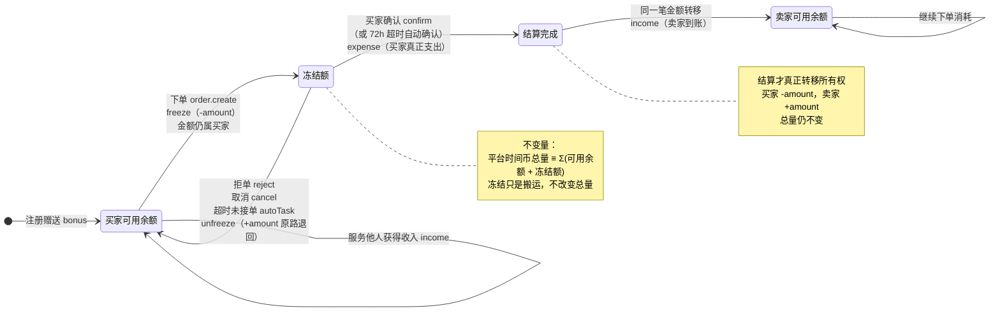
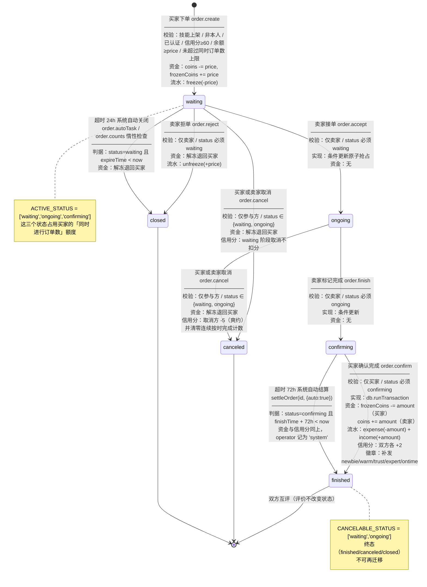

# 校园时间银行 · 核心机制说明

> 最后更新：2026-10 | 适用版本：v0.5.0

本文档对应答辩深挖，把 6 个核心机制讲透。每个机制统一按
**「问题 → 方案 → 代码位置 → 关键片段 → 为什么这么设计」** 五段式展开。

文中引用的**文件路径与函数名均已核对过实际代码**（见每节的「代码位置」）。
代码片段为便于阅读做了缩略，均不超过 15 行，完整实现请打开对应文件查看。

| # | 机制 | 主要文件 | 关键函数 |
|---|---|---|---|
| 1 | 时间币冻结—结算 | `cloudfunctions/order/index.js` | `actionCreate` / `closeAndRefund` / `settleOrder` / `addWalletLog` |
| 2 | 订单状态机 | `cloudfunctions/order/index.js` | `actionAccept` / `actionFinish` / `settleOrder` / `handleTimeouts` |
| 3 | 并发安全与一致性 | `cloudfunctions/order/index.js`、`_shared/index.js` | `db.runTransaction` / `canOrderSkill` / `orderLimitOf` |
| 4 | 信用分算法 | `_shared/index.js`、`cloudfunctions/order`、`user`、`Campus Time Bank/utils/credit.js` | `changeCredit` / `awardBadges` / `weightedRating` |
| 5 | 实时聊天 | `Campus Time Bank/pages/chat/room/room.js`、`cloudfunctions/message/index.js` | `_startRealtime` / `_stopRealtime` / `send` / `assertMember` |
| 6 | 附近技能地理查询 | `cloudfunctions/skill/index.js`、`_shared/index.js` | `actionList` / `parseGeo` / `withCondition` |

---

## 1. 时间币冻结—结算机制

### 问题

时间币是平台唯一的「货币」。如果下单时就直接从买家账上扣掉、打给卖家，
那么一旦出现下面三种情况，钱已经在别人账上，**平台没有任何技术手段追回**：

1. **卖家拒单** —— 服务没发生，但钱已经到账；
2. **24 小时无人接单** —— 订单自然失效，钱还在卖家那里；
3. **服务中途取消** —— 双方都不愿承担损失。

只能靠管理员手动改数据库来「追款」，那这套系统就不可信了 ——
它无法自己保证账目正确，只能靠人兜底。

### 方案

把「支出」拆成**两个阶段**：

| 阶段 | 触发 | 时间币变化 | 归属 |
|---|---|---|---|
| **冻结（freeze）** | 买家下单 `order.create` | `coins → frozenCoins`（可用减、冻结加） | **仍属买家**，只是被锁住不能再花 |
| **结算（settle）** | 买家确认完成 `order.confirm` | 买家`frozenCoins`减、卖家`coins`加 | 真正转移给服务者 |

中间任何失败路径（拒单 / 取消 / 超时）都走**解冻（unfreeze）**：
把金额从 `frozenCoins` 搬回 `coins`，买家一分不少。

### 资金流转图



### 代码位置

| 环节 | 文件 | 函数 |
|---|---|---|
| 冻结 | `cloudfunctions/order/index.js` | `actionCreate(event, openid)`（事务内） |
| 解冻 | `cloudfunctions/order/index.js` | `closeAndRefund(order, by, status, reason, remark, operator)` |
| 结算 | `cloudfunctions/order/index.js` | `settleOrder(orderId, opt)` |
| 写流水 | `cloudfunctions/_shared/index.js` | `addWalletLog(p)` |
| 注册赠送 | `cloudfunctions/login/index.js` | `login` action 内（`type: 'bonus'`） |

### 关键片段

**① 冻结（`actionCreate` 的事务内，约第 253-260 行）**：

```js
// ★ 绝对值写法：先算出结果再写，不用 _.inc()
const coins = (txBuyer.coins || 0) - amount
const frozenCoins = (txBuyer.frozenCoins || 0) + amount

await tx.collection(C.USERS).doc(buyer._id).update({
  data: { coins, frozenCoins, updateTime: createTime }
})
```

**② 解冻（`closeAndRefund` 的事务内，约第 162-169 行）**：

```js
const amount = Math.round(Number(o.amount) || 0)
// 绝对值写法：解冻 = 可用余额加回、冻结额减掉
const coins = (b.coins || 0) + amount
const frozenCoins = Math.max(0, (b.frozenCoins || 0) - amount)

await tx.collection(C.USERS).doc(buyerDoc._id).update({
  data: { coins, frozenCoins, updateTime: t }
})
```

**③ 结算（`settleOrder` 的事务内，约第 540-559 行）**：

```js
// 买家：冻结额释放并真正扣除（下单时已从 coins 扣走，此处只减冻结）
const bFrozen = Math.max(0, (b.frozenCoins || 0) - amount)
const bSpent = (b.totalSpent || 0) + amount
// 卖家：到账
const sCoins = (s.coins || 0) + amount
const sEarned = (s.totalEarned || 0) + amount

await tx.collection(C.USERS).doc(buyerDoc._id).update({
  data: { frozenCoins: bFrozen, totalSpent: bSpent, stats: bStats, updateTime: t }
})
await tx.collection(C.USERS).doc(sellerDoc._id).update({
  data: { coins: sCoins, totalEarned: sEarned, stats: sStats, updateTime: t }
})
```

**④ 写流水（事务外补写，`bestEffort` 包裹）**：

```js
async function bestEffort(label, fn) {
  try { return await fn() } catch (e) {
    console.error(`[order] 事务外补写失败（${label}）：`, (e && e.message) || e)
    return null
  }
}
// 结算后：
await bestEffort('settle.expenseLog', () => addWalletLog({ type: 'expense', amount: -r.amount, ... }))
await bestEffort('settle.incomeLog',  () => addWalletLog({ type: 'income',  amount:  r.amount, ... }))
```

### 为什么这么设计

**① 冻结的核心价值是「所有权未转移」。** `frozenCoins` 里的钱在法律与业务语义上都属于买家 ——
它不是「平台暂存」，也不是「卖家应收」。所以任何失败路径都能无条件原路退回，
不需要征得对方同意，也不需要平台垫付。这一点让退款逻辑变得极其简单：
`coins += amount; frozenCoins -= amount`，没有条件判断。

**② 让不变量可校验、可证明。** 因为下单只是「搬运」而非「转移」，
所以任何时刻都满足：

$$\sum_{\text{所有用户}} \texttt{coins} + \sum_{\text{所有用户}} \texttt{frozenCoins} = \text{const} \quad(\text{注册赠送与管理员调整除外})$$

管理端看板的 `overview.coinCirculation`（Σ coins）与 `coinFrozen`（Σ frozenCoins）
直接暴露了这两个量，随时可以对账。**一个能被一行公式验证的账务系统，才配叫「可信」。**

**③ 三种余额口径覆盖三种用户诉求。** `coins`（我现在能花多少）、
`frozenCoins`（我有多少被压着）、`coins + frozenCoins`（我到底有多少）。
钱包页同时展示这三者，用户不会因为下单后余额突然减少而产生「我的钱呢」的恐慌 ——
因为旁边就写着「冻结中：3」。

**④ 流水放在事务外是刻意的取舍。** 云开发事务有时长限制，
参与事务的文档越多越容易超时。而「写流水」的失败**不影响主流程正确性** ——
钱已经对了，只是账本少记一笔。所以用 `bestEffort()` 包起来：
失败只记 `console.error`，绝不把「已经成功的交易」变成客户端眼中的失败。
**这是「正确性优先于完整性」的取舍，但要明确记录在案**（详见 §1 末尾的风险说明）。

### 已知风险与改进

| 风险 | 后果 | 改进方向 |
|---|---|---|
| 流水在事务外补写，极端情况下可能丢失（事务成功但补写失败） | 用户余额正确，但明细页少一条记录，对账时会出现差额 | 引入「对账任务」：定时用 `Σ流水` 与 `users.coins` 比对，发现差异自动补记并告警 |
| `frozenCoins` 用 `Math.max(0, ...)` 兜底 | 若出现脏数据，冻结额会被夹到 0 而不报错，问题被掩盖 | 改为断言 + 告警：`assert(b.frozenCoins >= amount, '冻结额异常', 500)` |
| `wallet_logs` 的 `amount` 求和 ≠ 余额变化（freeze 与 expense 都是负数） | 直接汇总流水会重复计数 | 已在 `cloudfunctions/wallet/index.js` 里用 `INCOME_TYPES`/`EXPENSE_TYPES` 白名单过滤，避开这个坑 |

---

## 2. 订单状态机

### 问题

一个服务交易从「想买」到「钱到账」要经过多个阶段，每个阶段双方能做的事情不同。
如果没有明确的状态定义，会出现一系列问题：

1. **重复操作** —— 两个用户同时点「接单」会发生什么？
2. **时序错误** —— 卖家能不能在买家还没下单时就「标记完成」？
3. **越权操作** —— 买家能不能替卖家「接单」？
4. **资金悬空** —— 订单卡在某个状态不动，钱永远冻结着怎么办？

### 方案

定义 **6 个状态**、**9 条迁移路径**（其中 2 条由系统自动触发），
每条迁移都由云函数控制并附带三重校验：**身份校验 + 状态断言 + 资金动作**。



### 代码位置

`cloudfunctions/order/index.js`：

| action | 函数 | 关键实现 |
|---|---|---|
| `create` | `actionCreate` | `db.runTransaction`，冻结时间币 |
| `accept` | `actionAccept` | `.where({_id, status:'waiting'}).update()` 条件更新 |
| `reject` | `actionReject` | 调 `closeAndRefund(order,'seller','closed',...)` |
| `cancel` | `actionCancel` | 调 `closeAndRefund`；`wasOngoing` 时扣 5 分 |
| `finish` | `actionFinish` | `.where({_id, status:'ongoing'}).update()` 条件更新 |
| `confirm` | `actionConfirm` → `settleOrder` | `db.runTransaction`，结算 |
| `autoTask` | `actionAutoTask` → `handleTimeouts` | 定时触发器入口 |

状态常量（文件头部，第 28-30 行）：

```js
/** 进行中（占用买家「同时进行订单数」额度）的状态 */
const ACTIVE_STATUS = ['waiting', 'ongoing', 'confirming']
/** 可取消的状态 */
const CANCELABLE_STATUS = ['waiting', 'ongoing']
```

### 关键片段

**① 条件更新做原子抢占（`actionAccept`，约第 361-375 行）**：

```js
// 条件更新 = 原子抢占：并发的两个接单请求只有一个能改到 waiting 的文档
const res = await db.collection(C.ORDERS)
  .where({ _id: order._id, status: 'waiting' })
  .update({
    data: {
      status: 'ongoing',
      acceptTime: t,
      timeline: _.push([{ status: 'ongoing', time: t, remark: '服务者已接单', operator: openid }])
    }
  })
if (!res.stats || res.stats.updated !== 1) throw bizError(409, '该订单已被处理')
```

**② 状态断言防止非法迁移（`settleOrder`，约第 525-529 行）**：

```js
const r = await db.runTransaction(async tx => {
  const oRes = await tx.collection(C.ORDERS).doc(order0._id).get()
  const txOrder = oRes.data
  assert(txOrder, '订单不存在', 404)
  assert(txOrder.status === 'confirming', '当前状态不能确认', 409)   // ← 事务内再断言一次
  ...
})
```

**③ 手动确认与超时自动确认共用同一函数（`actionConfirm` vs `handleTimeouts`）**：

```js
// 手动：actionConfirm
async function actionConfirm(event, openid) {
  await requireUser(openid)
  const order = await findOrder(event.orderId)
  assert(order.buyerId === openid, '只有买家可以确认完成', 403)
  return settleOrder(order._id, { operator: openid })
}

// 自动：handleTimeouts 内部
await settleOrder(od._id, { auto: true, operator: 'system' })
// settleOrder 内部：
//   if (!auto) assert(order0.buyerId === o.operator, '只有买家可以确认完成', 403)
//   const actor = auto ? 'system' : order0.buyerId
```

**④ 超时兜底（`handleTimeouts`，约第 709-751 行）**：

```js
// ① 待接单超时 → 系统自动关闭并解冻退回
const res = await db.collection(C.ORDERS)
  .where({ status: 'waiting', expireTime: _.lt(t) })
  .limit(batch).get()
for (const od of (res.data || [])) {
  await closeAndRefund(od, 'system', 'closed', '超时未接单，系统自动取消', ..., 'system')
}
// ② 待确认超时 → 系统自动结算给服务者
const threshold = new Date(Date.now() - confirmHours * 3600000)
const res2 = await db.collection(C.ORDERS)
  .where({ status: 'confirming', finishTime: _.lt(threshold) })
  .limit(batch).get()
```

### 为什么这么设计

**① 用「条件更新」代替事务做原子抢占，是性能考虑。**
`accept` 与 `finish` 只改一个文档（订单本身），不涉及时间币。
用一个带状态条件的 `update` 就能实现原子性 —— 数据库保证「查询条件 + 更新」
是一个原子操作，`res.stats.updated` 就是抢到的凭证。
这比开事务轻量得多（不用锁定多个文档、不用重试机制）。
**原则：只有涉及多个文档且必须同生共死时才用事务。**

**② 状态断言写在事务内部，而不只在外面。**
外层断言（`actionConfirm` 里的 `assert(order.buyerId === openid)`）读的是事务外的快照，
在事务开始的间隙里状态可能已经变了。所以在事务内**重读订单并再断言一次**，
才能保证「判断依据」与「写入」基于同一份快照。这是幂等性的来源 ——
定时任务和用户请求可能同时触发结算，第二次会因为 `status !== 'confirming'` 直接抛 409 退出。

**③ 24 小时 vs 72 小时的差异化设计。**
`waiting` 超时 24 小时关闭：服务**没有发生**，应该尽快把钱还给买家，让他去找别人。
`confirming` 超时 72 小时自动确认：服务**大概率已经发生**（卖家主动标记了完成），
要给买家足够的时间去核实（可能他两天没上线），但也不能让卖家无限期等。
两者的差异体现了对**买卖双方风险**的平衡。

**④ 状态机是「前端只读、后端驱动」。**
`orders` 集合权限是「仅管理端可读写」，客户端**完全无法改状态**。
所有状态迁移都必须过云函数，而云函数里的三重校验
（身份 / 状态 / 资金）保证了「不该发生的事一定发生不了」。
前端 `utils/constants.js` 的 `ORDER_STATUS` 只负责**显示文案与颜色**，
不参与任何业务判断 —— 这使得前端可以随意改名、加图标，而不会影响状态机正确性。

---

## 3. 并发安全与数据一致性

### 问题

校园场景下并发不高，但**并非不存在**，而且一旦出错就是资金错误：

1. **同一用户重复点「立即预约」** —— 手抖或网络慢导致两次提交，
   会不会冻结两次时间币、生成两个订单？
2. **两个买家抢同一个技能**（价格 6 枚，各自余额 10 枚）——
   会不会两边都判定「余额够」，各扣 6 枚，最终余额变成 −2？
3. **两个并发接单请求** —— 两个「服务者」（或同一人重复点）同时接单，
   会不会都成功？
4. **定时任务与用户手动确认同时触发结算** —— 会不会结算两次，卖家收到双倍钱？
5. **事务内用 `_.inc()` 会不会算错？**

### 方案

按「操作的影响范围」分三档处理，各用最合适的手段：

| 档位 | 场景 | 手段 | 例子 |
|---|---|---|---|
| **档 1：单文档状态迁移** | 只改一个文档，且需要「状态匹配才生效」 | **条件更新**（`where({_id, status}).update()`）+ 检查 `stats.updated` | `accept`、`finish` |
| **档 2：多文档资金变动** | 涉及余额，必须同生共死 | **`db.runTransaction`** + **绝对值写入** | `create`、`closeAndRefund`、`settleOrder` |
| **档 3：纯计数、无需校验** | 只是累加，不需要基于旧值判断 | **`_.inc()`** 原子自增 | `skill.detail` 的 `viewCount` |

### 代码位置

| 机制 | 文件 | 函数 |
|---|---|---|
| 档 1 条件更新 | `cloudfunctions/order/index.js` | `actionAccept`、`actionFinish` |
| 档 2 事务 | `cloudfunctions/order/index.js` | `actionCreate`、`closeAndRefund`、`settleOrder` |
| 档 3 原子自增 | `cloudfunctions/skill/index.js` | `actionDetail`（`viewCount: _.inc(1)`） |
| 下单前置校验 | `cloudfunctions/_shared/index.js` | `canOrderSkill(skill, buyer, config)` |
| 同时订单数上限 | `cloudfunctions/order/index.js` 调用 / `cloudfunctions/_shared/index.js` 定义 | `orderLimitOf(scoreOrLevel)`（权威表在 `_shared` 的 `CREDIT_LEVELS[].limit`） |

### 关键片段

**① 余额校验与扣减在同一份快照内（`actionCreate` 事务，约第 241-260 行）**：

```js
const r = await db.runTransaction(async tx => {
  // 事务内重读技能与买家：价格、上架状态、余额都以同一份快照为准
  const sRes = await tx.collection(C.SKILLS).doc(skillId).get()
  const bRes = await tx.collection(C.USERS).doc(buyer._id).get()
  const txSkill = sRes.data
  const txBuyer = bRes.data
  canOrderSkill(txSkill, txBuyer, config)   // 上架中 / 不能买自己的 / 已认证 / 信用分 / 余额

  const amount = Math.round(Number(txSkill.price) || 0)
  const coins = (txBuyer.coins || 0) - amount        // ← 用同一份快照算绝对值
  const frozenCoins = (txBuyer.frozenCoins || 0) + amount
  await tx.collection(C.USERS).doc(buyer._id).update({ data: { coins, frozenCoins } })
  ...
})
```

**② 余额不足的判定（`_shared/index.js` 的 `canOrderSkill`）**：

```js
function canOrderSkill(skill, buyer, config) {
  if (!skill) throw new BizError(404, '技能不存在或已被删除')
  if (skill.status !== 1) throw new BizError(409, '该技能已下架，暂时无法下单')
  if (skill.authorId === buyer._openid) throw new BizError(409, '不能购买自己发布的服务')
  if (buyer.authStatus !== 2) throw new BizError(403, '请先完成校园认证')
  if ((buyer.creditScore || 0) < (config.minCreditToOrder || 60)) {
    throw new BizError(403, `信用分低于 ${config.minCreditToOrder || 60}，暂不能下单`)
  }
  if ((buyer.coins || 0) < skill.price) {
    throw new BizError(409, `时间币不足，还差 ${skill.price - (buyer.coins || 0)} 枚`)
  }
  return true
}
```

**③ 「同时进行订单数」上限（`actionCreate` 事务外预检）**：

```js
// orderLimitOf 从共享层导入（line 22：creditLevelOf, orderLimitOf, changeCredit, ... = require('./shared')）
// 权威定义在 _shared/index.js 的 CREDIT_LEVELS[].limit，order 云函数不再自己复刻一份
const limit = orderLimitOf(buyer.creditScore)          // 5 / 3 / 2 / 1 / 0
const activeRes = await db.collection(C.ORDERS)
  .where({ buyerId: buyer._openid, status: _.in(ACTIVE_STATUS) })
  .count()
if ((activeRes.total || 0) >= limit) {
  throw bizError(409, `你当前的信用等级「${levelTextOf(buyer.creditScore)}」最多同时进行 ${limit} 单...`)
}
```

**④ 为什么不用 `_.inc()`（对比两处代码）**：

```js
// ✅ 正确：浏览量不需要基于旧值判断，用原子自增（cloudfunctions/skill/index.js）
await db.collection(C.SKILLS).doc(skill._id).update({ data: { viewCount: _.inc(1) } })

// ✅ 正确：余额必须基于同一份快照判断，用绝对值（cloudfunctions/order/index.js）
const coins = (txBuyer.coins || 0) - amount
await tx.collection(C.USERS).doc(buyer._id).update({ data: { coins, frozenCoins } })

// ❌ 错误示范（本项目未使用）：事务内用增量，校验与写入脱钩
// assert(txBuyer.coins >= amount)                          // 基于快照 A 判断
// await tx...update({ data: { coins: _.inc(-amount) } })   // 基于服务端值 B 写入
```

### 为什么这么设计

**① 事务的乐观并发控制是如何避免超卖的。**

云开发数据库事务采用**乐观并发控制**。场景：余额 10 枚，两个请求各想扣 6 枚。

```
请求 P1                          请求 P2
────────                         ────────
事务开始                          事务开始
读 users → coins = 10             读 users → coins = 10        ← 两者读到同一快照
校验 10 >= 6 ✅                    校验 10 >= 6 ✅
算出 coins = 4                    算出 coins = 4
update { coins: 4 }               update { coins: 4 }
COMMIT ✅ 成功                    COMMIT ❌ 写冲突！自动重试整个事务函数
                                  重试：读 users → coins = 4
                                  校验 4 >= 6 ❌ → 抛 409，事务回滚
                                  客户端收到「时间币不足，还差 2 枚」
```

关键在于：**「够不够」和「扣没扣」是在同一份快照上的一个原子判断**。
不存在两边都读到 10 枚、各扣 6 枚的经典超卖。

**② 为什么必须用绝对值写入 —— 三条理由。**

- **保持「校验依据」与「写入结果」的一致性。** 事务的全部意义在于
  「读 → 判断 → 写」三步不可分割。若写入用 `_.inc(-amount)`，
  那么写入表达式与服务端当前值是绑定的，而校验用的是 JS 里读到的快照值 ——
  两者一旦脱钩，校验就失去了意义。
- **结果可预测、可复现、易调试。** 绝对值写法下，云函数日志里打出的 `coins`
  就是最终落库的值；出问题可以直接从日志完整还原当时的计算过程。
  增量指令的结果取决于服务端当时的值，日志无法还原。
- **便于论证多字段一致性。** 结算时要同时保证买家 `frozenCoins -= amount` 与
  卖家 `coins += amount`，两边都用同一份快照读出的 `amount` 计算，
  才能论证「时间币总量守恒」。混用增量指令会破坏这个论证。

**③ `_.inc()` 并非不能用，而是要分清场景。**
浏览量 `viewCount` 是典型的正确用法：它**不参与任何业务判断**，
只是纯粹的计数器，用原子自增既高效又避免读改写竞争。
**判断标准：这个字段的新值需要基于旧值做业务判断吗？需要 → 绝对值；不需要 → 可以 `_.inc()`。**

**④ 「同时进行订单数」上限是防刷单的软性约束。**
它不涉及金额正确性，所以放在**事务外的预检**里（成本更低）。
这意味着极端并发下可能有人突破上限 1 单 —— 但这个偏差不会造成资金错误，
只是让某个高并发用户多开了一单，风险可接受。
**这是「强一致用在关键处、弱一致用在非关键处」的典型取舍。**

**⑤ 事务边界外的一切都做了容错。**
事务只覆盖「资金 + 订单状态 + 统计」这四类必须一致的写入；
流水、通知、订阅消息、徽章补发全部用 `bestEffort()` 包裹在事务外。
这样做的代价是可能丢流水（见 §1 风险表），
收益是**事务足够短，不会因为发送一条订阅消息失败而回滚一笔已经成功的交易**。

### 一致性保障总结

| 一致性需求 | 保障手段 | 强度 |
|---|---|---|
| 余额不会算错 | 事务 + 绝对值写入 | **强**（ACID） |
| 不会重复结算 / 重复退款 | 事务内状态断言 + 条件更新 `stats.updated` | **强** |
| 不会超卖 | 事务写冲突自动重试 + 同一快照校验 | **强** |
| 不会重复接单 | 条件更新原子抢占 | **强** |
| 时间币总量守恒 | 冻结/解冻/结算都不改变总量（转移而非增发） | **强**（可公式验证） |
| 同时订单数不超限 | 事务外预检 | 弱（极端并发下可能超出 1 单，无资金影响） |
| 流水不丢 | `bestEffort` + 日志 | **弱**（已列入改进项） |
| 通知必达 | `bestEffort` + 站内通知兜底 | **弱**（可接受，用户下次进列表能看到） |

---

## 4. 信用分算法

### 问题

时间币解决了「用什么计价」，但没有解决「凭什么信任对方」。具体三个问题：

1. **怎么量化一个用户的可靠程度？** 需要一个能横向比较、能随行为变化的单一指标。
2. **新用户和老用户怎么公平对待？** 一个刚注册的人不应该因为数据少就被判定为不可信；
   一个三年前口碑很好但最近频繁爽约的人，也不应该一直吃老本。
3. **分数高了有什么实际好处？** 如果高分只是好看，用户就没有动力维护它。

### 方案

三层设计：**基础分 + 事件增减分 + 分级权益**，外加一套**时间衰减加权**用于展示综合评分。

```
                 ┌──────────────────────────────────────┐
                 │  初始信用分 BASE_SCORE = 100          │
                 │  区间限幅 clampScore → [0, 150]       │
                 └───────────────┬──────────────────────┘
                                 │
          ┌──────────────────────┼──────────────────────┐
          ▼                      ▼                      ▼
   ┌─────────────┐       ┌─────────────┐       ┌─────────────┐
   │  加分事件    │       │  减分事件    │       │  行为激励    │
   │ 完成单  +2  │       │ 4星    0    │       │ 连续5单  +3 │
   │ 5星     +1  │       │ 3星   -1    │       │ （一次爽约   │
   │             │       │ 2星   -2    │       │   归零）     │
   │             │       │ 1星   -3    │       │             │
   │             │       │ 爽约  -5    │       │             │
   │             │       │ 举报 -10    │       │             │
   └──────┬──────┘       └──────┬──────┘       └──────┬──────┘
          └──────────────────────┼──────────────────────┘
                                 ▼
                 ┌──────────────────────────────────────┐
                 │  分数变化 → changeCredit()            │
                 │  ① 更新 users.creditScore / creditLevel│
                 │  ② 写 credit_logs（可追溯）            │
                 │  ③ 跨过 120 分时补发 trust 徽章        │
                 └───────────────┬──────────────────────┘
                                 ▼
                 ┌──────────────────────────────────────┐
                 │  分级权益（决定可同时进行订单数）       │
                 │  120-150 极佳 excellent → 5 单        │
                 │  100-119 优秀 good      → 3 单        │
                 │   80-99  良好 normal    → 2 单        │
                 │   60-79  一般 weak      → 1 单        │
                 │    0-59  受限 limited   → 0 单（禁下单）│
                 └──────────────────────────────────────┘
```

### 计算规则

**① 事件增减分**（`Campus Time Bank/utils/constants.js` 的 `CREDIT_RULES` + 云函数实现）：

| reason key | 变化 | 触发条件 | 实现位置 |
|---|---|---|---|
| `order_finish` | `+2` | 订单顺利完成（买卖双方各一次） | `order/index.js` 的 `settleOrder` |
| `review_5` | `+1` | 收到 5 星评价 | `user/index.js` 的 `reviewCreate` |
| `review_4` | `0` | 收到 4 星评价 | 同上（`delta === 0` 时不写流水） |
| `review_3` | `-1` | 收到 3 星评价 | 同上 |
| `review_2` | `-2` | 收到 2 星评价 | 同上 |
| `review_1` | `-3` | 收到 1 星评价 | 同上 |
| `cancel_after_accept` | `-5` | 接单后取消 / 爽约（原状态为 `ongoing`） | `order/index.js` 的 `actionCancel` |
| `report_valid` | `-10` | 被举报且管理员核实成立 | `admin/index.js` 的 `handleReport` |
| `ontime_streak` | `+3` | 连续 5 单按时完成 | `order/index.js` 的 `settleOrder`（`streak % 5 === 0`） |
| `admin_adjust` | 任意 | 管理员手动调整 | `admin/index.js` |

**② 综合评分的时间衰减加权公式**（用于展示「评分」，不改变信用分）：

$$w_i = 0.9^{\,\Delta t_i / 24}, \qquad \Delta t_i = \text{第 } i \text{ 条评价距现在的小时数}$$

$$\text{综合评分} = \frac{\displaystyle\sum_{i=1}^{n} \text{score}_i \cdot w_i}{\displaystyle\sum_{i=1}^{n} w_i}$$

其中 $n$ 为评价总数，$\text{score}_i \in [1,5]$ 为第 $i$ 条评价的星级。

**半衰期**：令 $w = 0.5$，解得 $\Delta t = 24 \log_{0.9} 0.5 \approx 24 \times 6.579 \approx 158$ 小时
≈ **6.6 天**。即：评价每过约 6.6 天，其权重减半。

| 距今天数 | 权重 $w_i$ | 直观含义 |
|---|---|---|
| 0 天（今天） | `1.000` | 完全权重 |
| 1 天 | `0.900` | |
| 3 天 | `0.729` | |
| 7 天 | `0.478` | 约半权重 |
| 14 天 | `0.229` | |
| 30 天 | `0.042` | 几乎不影响 |
| 60 天 | `0.002` | 可忽略 |

**③ 分级权益**（`constants.js` 的 `CREDIT_LEVELS`）：

| 分数 | 等级 key | 中文 | 可同时进行订单数 | 附加权益 |
|---|---|---|---|---|
| `120-150` | `excellent` | 极佳 | **5** | 广场展示「信用之星」角标（`trust` 徽章） |
| `100-119` | `good` | 优秀 | 3 | 初始分 100 落在这里 |
| `80-99` | `normal` | 良好 | 2 | |
| `60-79` | `weak` | 一般 | 1 | |
| `0-59` | `limited` | 受限 | **0** | 禁止下单，仅可浏览 |

### 代码位置

| 环节 | 文件 | 函数 |
|---|---|---|
| 统一的分数变更入口 | `cloudfunctions/_shared/index.js` | `changeCredit(openid, change, reason, reasonText, orderId)` |
| 等级判定 | `cloudfunctions/_shared/index.js` | `creditLevelOf(score)` + `CREDIT_LEVELS` 表 |
| 订单完成 / 连续按时加分 | `cloudfunctions/order/index.js` | `settleOrder`（事务外补写②③） |
| 评价星级联动 | `cloudfunctions/user/index.js` | `reviewCreate`（`deltaMap`） |
| 爽约扣分 | `cloudfunctions/order/index.js` | `actionCancel`（`wasOngoing` 分支） |
| 举报成立扣分 | `cloudfunctions/admin/index.js` | `handleReport` |
| 同时订单数表 | `cloudfunctions/_shared/index.js`（**唯一权威定义**） | `orderLimitOf(scoreOrLevel)` + `CREDIT_LEVELS[].limit` |
| 前端展示副本 | `Campus Time Bank/utils/credit.js` | `clampScore` / `getLevel` / `getOrderLimit` / `weightedRating` / `nextLevel` |

### 关键片段

**① 分数变更的唯一入口（`_shared/index.js`，约第 220-246 行）**：

```js
async function changeCredit(openid, change, reason, reasonText, orderId) {
  if (!change) return null
  const u = await getUser(openid)
  if (!u) return null
  const score = Math.min(150, Math.max(0, (u.creditScore || 100) + change))  // ← 限幅
  await db.collection(C.USERS).doc(u._id).update({
    data: { creditScore: score, creditLevel: creditLevelOf(score), updateTime: now() }
  })
  await db.collection(C.CREDIT_LOGS).add({
    data: { _openid: openid, change, score, reason: reason || 'other',
            reasonText: reasonText || '信用分变动', orderId: orderId || '', createTime: now() }
  })
  // 信用分跨过 120 时补发「信用之星」徽章
  const badges = (u.badges || []).slice()
  if (score >= 120 && badges.indexOf('trust') < 0) {
    badges.push('trust')
    await db.collection(C.USERS).doc(u._id).update({ data: { badges } })
  }
  return score
}
```

**② 评价星级 → 信用分（`cloudfunctions/user/index.js`，约第 308-311 行）**：

```js
// 4) 信用分联动（delta 为 0 时不调 changeCredit，避免无意义的流水）
const deltaMap = { 5: 1, 4: 0, 3: -1, 2: -2, 1: -3 }
const delta = deltaMap[score] || 0
if (delta) await changeCredit(toId, delta, 'review_' + score, `收到 ${score} 星评价`, order._id)
```

**③ 连续按时完成奖励（`cloudfunctions/order/index.js`，约第 624-629 行）**：

```js
// —— 事务外补写 ③：连续 5 单按时完成奖励 ——
const streak = (r.sellerStats && r.sellerStats.ontimeStreak) || 0
if (streak > 0 && streak % 5 === 0) {
  await bestEffort('settle.streakBonus', () => changeCredit(
    r.order.sellerId, 3, 'ontime_streak', '连续 5 单按时完成', r.order._id
  ))
}
```

**④ 时间衰减加权（`Campus Time Bank/utils/credit.js`，约第 39-54 行）**：

```js
function weightedRating(reviews) {
  const list = (reviews || []).filter(r => r && r.score)
  if (!list.length) return 0
  let sw = 0, ss = 0
  const now = Date.now()
  list.forEach(r => {
    const t = r.createTime ? new Date(...).getTime() : now
    const days = Math.max(0, (now - t) / 86400000)
    const w = Math.pow(0.9, days)         // ← w_i = 0.9 ^ (距今天数)
    sw += w
    ss += Number(r.score) * w
  })
  if (!sw) return 0
  return Math.round((ss / sw) * 10) / 10  // 保留 1 位小数
}
```

### 为什么这么设计（逐条说明取值理由）

**① 为什么初始分是 100，而不是 0？**

- **新人不能被歧视。** 如果用 0 分起步，新用户在下单前就必须先攒分，
  而攒分的唯一途径是完成订单 —— 但他因为分不够不能下单，形成死锁。
  100 分起步让新用户一注册就拥有「正常用户」的待遇（`good` 等级，可同时 3 单）。
- **100 是个好记的基准。** 分数的语义变成「你在基准线之上还是之下」，
  用户一眼就能理解 112 分意味着「比新人好一点」，85 分意味着「最近有失分」。
- **留出单向空间。** 从 100 起，往上 50 分的空间（需要长期积累），
  往下 100 分的空间（几次严重违规就能掉到受限）。这样扣分比加分更「快」，
  符合「失信容易、取信难」的常识。

**② 为什么加分都很小（+1 / +2 / +3）？**

防止**刷单套利**。如果完成一单加 10 分，两个用户互相刷 5 单就能从 100 冲到 150 拿满权益。
现在的设计下，从 100 到 150 需要**至少 25 次真实的成功订单且零差评零爽约**，
而且要突破「同时进行订单数」的分级限制（初始只能同时 3 单），
刷单的成本变得很高。加分小还带来另一个好处：
**分数不容易因为一次大额加分而跳级**，等级变化是渐进的、可预期的。

**③ 为什么减分是递增的（−1 / −2 / −3）？**

**差的越狠，罚得越重**，这是让评价有区分度的关键。
如果 1 星和 3 星都扣 1 分，用户就不会在意「一般」和「很差」的区别。
现在：3 星只扣 1 分（相当于「尚可接受，略有瑕疵」），
1 星扣 3 分（「明确失望」），差距是 3 倍。
再往上，爽约 −5（几乎是一次 1 星的两倍），
因为它**实际损害了对方的等待时间**，性质比差评更恶劣。

**④ 为什么爽约扣 5 分？**

爽约的本质是「对方按约定来了，你却没来」——**浪费的是对方不可挽回的时间**。
这比一次体验不佳的差评严重得多，所以给到 −5：
相当于抵消 2.5 次成功订单（+2 each），
即「一次爽约要用 2.5 次成功服务来弥补」。
同时 `resetStreak()` 会把 `ontimeStreak` 清零，
意味着已经攒了 4 单的连续按时记录作废 —— 这是**双重惩罚**，
对「快拿到 +3 奖励时故意爽约」形成了有效抑制。

**⑤ 为什么举报成立扣 10 分（最重）？**

这是**唯一需要管理员人工判定**的规则，代表「触碰平台底线」
（诈骗、骚扰、违规内容）。它不该被轻描淡写地处理：

- 10 分相当于 5 次成功订单，一次违规要很久才能恢复；
- 如果被举报人原本在 100 分，扣完变 90 分 → 等级从 `good`（3 单）掉到 `normal`（2 单），
  **权益立刻缩水**，是真实可感知的惩罚；
- 如果原本就在 60-69 分的边缘，扣完直接进入 `limited`（禁止下单），
  形成了"累犯加重"的效果。

**⑥ 为什么连续 5 单按时完成只加 3 分？**

奖励的是**长期稳定**而非单次表现。3 分不算多（只比一次订单多 1 分），
但它的意义在于：这是一个**只有连续行为才能触发**的规则。
一次爽约会 `resetStreak()` 清零，所以这 3 分实际上是对「连续 5 次不出差错」的溢价。
5 这个数字是这样定的：**足够长以至于不能靠运气达成，足够短以至于普通活跃用户能看到希望**
（一个每月完成 3-4 单的用户，约 1.5 个月就能拿到一次）。

**⑦ 为什么用时间衰减加权（0.9 的底数）？**

- **它强调近期表现，但不丢弃历史。** 如果用「只统计最近 10 条评价」这种滑窗法，
  老评价会被硬切断，一个口碑很好但很久没接单的用户会被误判为新用户。
  指数衰减是平滑的：30 天前的评价权重只剩 4%，但**仍然存在**，
  对总分有微小贡献。这更符合真实的信任感知。
- **0.9 对应的半衰期约 6.6 天，与校园服务场景的节奏匹配。**
  校园技能服务的典型周期是一周（约在周末进行），
  所以「上周的评价权重约 50%、两周前的约 20%」是合理的 ——
  一个月内的口碑占主导，更早的只作参考。
- **计算极其廉价。** `Math.pow(0.9, days)` 一次幂运算，
  前端 `weightedRating()` 和服务端都能实时算，**不需要任何定期重算任务**。
  如果用「按时间窗口分箱 + 加权」的方案，就需要一个定时任务来滚动窗口。

**⑧ 为什么上限是 150？**

| 理由 | 展开 |
|---|---|
| **保持区分度** | 信用分的用途是**分级授权益**（决定可同时进行几单）。若无上限，长期活跃用户的分数会趋向无穷，所有人都顶到最高等级，分级就失去了区分能力。150 让「极佳」始终是少数人 |
| **让满分成为有难度的目标** | 从 100 到 150 至少需要 25 次成功订单且零差评零爽约（按每单 +2 计算）。这是个**有挑战但可达**的目标，给长期用户一个持续的动力 |
| **让扣分有真实痛感** | 上限 150 意味着有 50 分的上行空间。一次爽约 −5、一次举报 −10，从 130 分掉到 119 分就会从 `excellent`（5 单）掉到 `good`（3 单），**权益损失立即可感知**。如果上限是 1000，扣 10 分就无关痛痒 |
| **与下限 0 对称可读** | 下限 0 保证分数不会为负（避免「负分比 0 分更差」时的分级判定歧义）；上限 150 让「100 基准 ±50」成为一个直观的心智模型 |

**⑨ 为什么下限是 0？**

避免负分带来的逻辑歧义。如果允许负分，就需要回答
「−20 分和 −5 分哪个更差」「`limited` 等级要不要再细分」这类无意义的问题。
截断在 0 分、`limited` 等级（禁止下单），语义清晰：
**你已经不能下单了，再扣也没意义，只能通过帮助别人慢慢把分赚回来。**

**诚实的局限**：这些权重的具体数值（`+2 / −5 / −10` 与 `150` 的上限）
都是**基于经验的取值**，参考了常见信用评级体系的「基准分 + 上行空间」比例，
但**缺少本校真实数据的校准**。更好的做法是收集一个学期的真实评价与爽约数据，
以「预测爽约概率」为目标做参数拟合。这一点已列入改进方向。

---

## 5. 实时聊天

### 问题

需要实现「A 发一条消息，B 的聊天室界面立刻出现」。朴素方案是客户端定时轮询，
但它有三个明显缺点：延迟高（要么费流量要么慢）、服务器压力随用户数线性增长、
体验差。而如果要做真正的推送，传统方案要自建 WebSocket 服务 ——
对一个云开发项目来说，这违背了「零运维」的初衷。

同时还有安全与隐私问题：

1. **不能让任何人给任何人发消息** —— 必须限制在会话成员之间；
2. **不能让客户端直接写消息集合** —— 否则可以伪造任意发送者；
3. **不能让连接泄漏** —— 每个用户开一个聊天室就占一条长连接。

### 方案

用云开发**原生的 `watch` 长连接**，并对权限做「读开放、写收紧」的差异化设计：

```
┌──────────────────────────────────────────────────────────────────────────┐
│  messages 集合权限：所有用户可读，仅创建者可写                            │
├──────────────────────────────────────────────────────────────────────────┤
│                                                                          │
│   客户端 ──── db.collection('messages')                                  │
│              .where({ chatId })                                          │
│              .orderBy('createTime', 'asc')                               │
│              .watch({ onChange, onError })                               │
│                    │                                                     │
│                    │  ← 开放【读】权限才能建立长连接                       │
│                    ▼                                                     │
│              服务端主动推送全量结果集                                      │
│              snapshot.docs 直接 setData                                   │
│                                                                          │
├──────────────────────────────────────────────────────────────────────────┤
│                                                                          │
│   客户端 ──── api.message.send({ chatId, toId, content })                 │
│                    │                                                     │
│                    │  ← 【写】必须过云函数（集合权限禁止客户端直写）        │
│                    ▼                                                     │
│              cloudfunctions/message/index.js                             │
│              assertMember(chat, me._openid)   ← 校验会话成员身份           │
│              content 非空 且 ≤1000 字                                     │
│              toId 必须在 chat.members 中                                 │
│                    │                                                     │
│                    ▼                                                     │
│              写入 messages（显式写 _openid = 发送者）                      │
└──────────────────────────────────────────────────────────────────────────┘
```

**断线降级链路**：

```
尝试建立 watch
      │
      ├─ 成功 ──→ onChange 实时推送（毫秒级）
      │              │
      │              └─ onError（断网 / 权限变动 / 长连接被回收）
      │                     │
      │                     ├─ ① watcher.close() 关闭失效连接
      │                     ├─ ② realtimeDegraded = true（UI 提示）
      │                     ├─ ③ util.toast('实时连接已断开，已切换轮询')
      │                     └─ ④ 启动 3 秒轮询（message.history）
      │
      └─ 抛异常（云环境未就绪）──→ 直接降级轮询

MOCK 离线模式 ──→ 不走 watch（必然失败），直接 2 秒轮询 + mockMode 提示

页面销毁 onUnload ──→ _stopRealtime() ──→ watcher.close() + clearInterval()
                                          ★ 必须，否则长连接泄漏
```

### 代码位置

| 环节 | 文件 | 函数 / 位置 |
|---|---|---|
| 建立实时监听 | `Campus Time Bank/pages/chat/room/room.js` | `_startRealtime()` |
| 轮询降级 | 同上 | `_startPolling(interval, isMock)` |
| 停止一切实时通道 | 同上 | `_stopRealtime()` / `_stopPolling()` |
| 页面卸载清理 | 同上 | `onUnload()`（第 125-135 行） |
| 本地乐观插入合并 | 同上 | `_withPending(docs)` |
| 发送消息（服务端校验） | `cloudfunctions/message/index.js` | `send` action |
| 成员身份断言 | `cloudfunctions/message/index.js` | `assertMember(chat, openid)`（第 52-54 行） |
| 打开/创建会话 | `cloudfunctions/message/index.js` | `openChat` action（`members` 升序） |

### 关键片段

**① 建立 watch 与断线降级（`room.js` 的 `_startRealtime`，约第 186-217 行）**：

```js
const db = wx.cloud.database()
this.watcher = db.collection('messages')
  .where({ chatId: chatId })
  .orderBy('createTime', 'asc')
  .watch({
    onChange: snapshot => {
      const docs = (snapshot && snapshot.docs) || []   // 全量当前结果集
      const list = this._withPending(docs)
      this._raw = list
      this._render(list.slice(-MAX_MESSAGES))
      this.setData({ realtimeDegraded: false })
    },
    onError: err => {
      // 实时连接失败 → 降级为 3 秒轮询，并提示用户
      if (this.watcher) { try { this.watcher.close() } catch (e) {}; this.watcher = null }
      this.setData({ realtimeDegraded: true })
      util.toast('实时连接已断开，已切换轮询')
      this._startPolling(POLL_INTERVAL, false)
    }
  })
```

**② 页面销毁必须关闭连接（`room.js` 的 `onUnload`，第 125-135 行）**：

```js
onUnload() {
  // ★★ 必须：关闭 watch 长连接 + 清掉轮询定时器，否则连接泄漏
  this._destroyed = true
  this._stopRealtime()
  if (this._onKeyboard) {
    wx.offKeyboardHeightChange(this._onKeyboard)
    this._onKeyboard = null
  }
  const app = getApp()
  app.refreshTabBadge()
}
```

**③ 轮询里防「已卸载页面 setData」（`room.js` 的 `_startPolling`）**：

```js
_startPolling(interval, isMock) {
  this._stopPolling()
  this.pollTimer = setInterval(async () => {
    // 页面已销毁就直接退出，避免在已卸载的页面上 setData
    if (this._destroyed) return
    try {
      const res = await api.message.history({ chatId: this.data.chatId, page: 1, size: PAGE_SIZE })
      const list = this._withPending((res && res.list) || [])
      this._raw = list
      this._render(list.slice(-MAX_MESSAGES))
      this.markRead(true)   // silent
    } catch (e) { /* 轮询失败静默处理，下一次继续 */ }
  }, interval || POLL_INTERVAL)
  if (isMock) this.setData({ mockMode: true })
}
```

**④ 服务端的成员校验（`cloudfunctions/message/index.js`，第 52-54 行与 `send`）**：

```js
function assertMember(chat, openid) {
  assert((chat.members || []).indexOf(openid) > -1, '你不在该会话中', 403)
}

// send action 中：
assertMember(chat, me._openid)
assert(content.trim(), '消息内容不能为空', 400)
assert(content.length <= 1000, '消息内容不能超过 1000 字', 400)
const toId = event.toId || (chat.members || []).find(m => m !== me._openid)
assert((chat.members || []).indexOf(toId) > -1, '接收者不在该会话中', 400)
// ★ messages 权限为「所有用户可读，仅创建者可写」，_openid 必须显式写成发送者
await db.collection(C.MESSAGES).add({
  data: { _openid: me._openid, chatId: chat._id, fromId: me._openid, toId, type, content, read: false, createTime: now() }
})
```

**⑤ 会话唯一性（`openChat`，`members` 升序排列）**：

```js
// members 按 openid 字符串升序排列，保证 (A,B) 与 (B,A) 只会有一条会话
const members = [me._openid, toId].sort()
const found = await db.collection(C.CHATS).where({ members: _.all(members) }).limit(1).get()
```

### 为什么这么设计

**① `watch` 的原理决定了它必须有客户端读权限。**

`watch` 是云开发提供的长连接实时推送能力。客户端**以小程序用户身份**直连数据库
建立连接，第一次会拿到当前查询结果集的全量快照，
之后任何影响该结果集的写入都由服务端**主动推送新的全量快照**。

关键点在于：这个连接的身份是「用户」而不是「云函数」。
所以如果 `messages` 的权限是「仅管理端可读写」，
客户端连 `db.collection('messages').get()` 都拿不到数据，`watch` 会立即 `onError`。
**这是「读权限开放」的根本原因 —— 不是设计疏忽，而是云开发实时能力的硬性前置条件。**

**② `snapshot.docs` 是全量结果集，这让前端逻辑极大简化。**

`onChange` 回调里的 `snapshot.docs` 不是「变更的增量」，而是**当前完整的查询结果集**。
所以前端不需要做 diff、不需要维护本地列表的增删改、不需要处理乱序，
直接 `this.setData({ messages: snapshot.docs })` 就行。
这比「服务端推送增量 + 客户端合并」的方案简单得多，也更不容易出 bug。

**③ 写入必须走云函数，是安全底线。**

因为集合权限是「所有用户可读，**仅创建者可写**」，
客户端理论上可以**创建**自己的消息文档（`_openid` 会是自己）。
但它无法伪造 `fromId` —— 更准确地说，即使伪造了写入，
服务端校验这一层仍然保证：

- 发消息必须通过 `message.send`，那里有 `assertMember()` 检查发送者确实在会话里；
- `toId` 必须也在 `chat.members` 里，防止往不相干的会话塞消息；
- 内容非空且 ≤1000 字，防滥用。

**更重要的是业务数据必须由服务端生成**（`createTime`、`read` 状态等），
否则客户端可以伪造时间或把消息标记为已读来隐藏痕迹。

**④ 降级是必需的，不是可选的。**

`watch` 长连接会在这些情况下断开：**网络切换**（WiFi ↔ 4G）、
**小程序进入后台被回收**、**云环境权限配置变动**、**长时间空闲**。
如果不处理 `onError`，用户会发现「消息再也不来了」，
而且界面上没有任何提示 —— 这是最糟糕的体验。

所以降级策略是：**先关掉失效连接（避免残留），再切 3 秒轮询（保证功能可用），
最后明确告知用户「已切换轮询」**。第三点常被忽略但很重要：
**用户需要知道实时性变化了**，否则他会以为是对方没回消息。

轮询间隔选 3 秒是因为：聊天场景下人对延迟的容忍度大约在 2-3 秒，
再快会浪费流量（每次轮询都是一次云函数调用），再慢就会有明显卡顿感。

**⑤ `onUnload` 关闭连接是防泄漏的关键。**

`watch` 建立的是**长连接**，每个聊天室占一条。用户如果来回进出聊天室 20 次，
就会累积 20 条僵尸连接 —— 轻则消耗云开发配额，重则后续连接建立失败（
超过并发连接上限）。所以项目把清理逻辑统一收进 `_stopRealtime()`：

```js
_stopRealtime() {
  if (this.watcher) { try { this.watcher.close() } catch (e) {}; this.watcher = null }
  this._stopPolling()
}
_stopPolling() {
  if (this.pollTimer) { clearInterval(this.pollTimer); this.pollTimer = null }
}
```

`onUnload` 与 `onHide` 都调用它，并且 `_destroyed = true` 让轮询回调能感知页面已销毁，
避免「在已卸载的页面上 `setData`」这类报错。

**⑥ MOCK 模式下走轮询是刻意的。**

离线预览时没有云环境，`watch` 必然失败。如果只是让它失败降级，
控制台会一直报错，体验很差。所以 `_startRealtime()` 开头就有分支：

```js
if (app.globalData.MOCK) {
  this._startPolling(MOCK_INTERVAL, true)   // 2 秒轮询 + mockMode 标记
  return
}
```

这样答辩彩排时消息也能「动起来」，录屏演示不会显得死板。

**⑦ `_withPending()` 解决了「发了消息但还没回来」的体验问题。**

发送消息后，如果是 MOCK 轮询模式，要等下一次 tick（2 秒）才能看到自己的消息。
所以项目维护了一个 `this._pending` 本地列表做**乐观插入**：
发送时立刻把消息推进界面，等服务端返回同 `_id` 的消息时自动覆盖，
避免重复显示。这个细节让离线演示和弱网下的体验都明显更好。

### 已知风险与改进（诚实说明）

| 风险 | 严重程度 | 改进方向 |
|---|---|---|
| **`messages` 开放读权限** —— 理论上任何用户都能构造查询读取全部消息文档 | ⚠️ **中高**（隐私） | 改为「云函数推送 + 客户端轮询自己的 `toId`」（`where({toId: me})` 只看自己的收件箱），或自建 WebSocket 服务。代价是失去原生实时能力、实时性从毫秒降到秒级 |
| `chats` 同样开放读权限 | 低（会话只含 `members` / `memberInfos` / `lastMsg`，敏感度低于消息正文） | 同上，可以一并收紧 |
| 轮询降级期间消息延迟 3 秒 | 低（可接受） | 可以改为「指数退避轮询」（前几次 1 秒，稳定后拉长到 5 秒），在延迟与流量间取得更好平衡 |
| 长消息（接近 1000 字）在列表中截断显示 | 低 | 已用 `lastMsg` 摘要字段处理 |

**我认为把这条隐私风险主动讲出来比被问出来要好** ——
它体现了对「实时能力与最小权限原则存在张力」这一工程现实的理解。

---

## 6. 附近技能的地理查询

### 问题

「附近技能」这个功能有三个具体需求：

1. **按距离筛选** —— 只显示 X 米范围内的技能；
2. **按距离排序** —— 最近的排在最前面；
3. **显示距离** —— 卡片上要显示「320m」这样的文字。

朴素方案是把所有技能的经纬度拉到应用层，用 Haversine 公式逐条算距离再排序。
但这有三个问题：**数据量大时要把全量技能传到云函数**（网络与内存开销）、
**无法在数据库层做筛选**（所以在分页上很别扭）、**每次查询都要重复计算**。

另一种方案是引入腾讯位置服务（LBS）的「周边搜索」接口。
但这需要申请 Key、管理配额、多一层网络依赖 —— 而它提供的核心能力正好是
**数据库已经原生提供**的。

### 方案

用微信云开发**内置的地理位置能力（GeoPoint + geoNear）**，零第三方依赖：

```
发布技能时（一次性写入）
────────────────────────
wx.chooseLocation()  →  { latitude, longitude, name, address }
        │
        ▼  cloudfunctions/skill/index.js 的 create / update
location: geo ? db.Geo.Point(geo.lng, geo.lat) : null     ← 云开发地理点类型
address / locationName  ← 详细地址与地点名（纯文本，用于展示）


查询「离我最近」时（每次查询）
──────────────────────────────
前端 sort='near' + longitude/latitude + radius（默认 3000 米）
        │
        ▼  cloudfunctions/skill/index.js 的 actionList
const near = withCondition(where, {
  location: _.geoNear({
    geometry: db.Geo.Point(geo.lng, geo.lat),
    maxDistance: radius
  })
})
        │
        ▼  一次数据库查询同时完成三件事：
        ① 按距离筛选（maxDistance）
        ② 按距离排序（orderBy('location', 'asc') —— geoNear 天然距离升序）
        ③ 返回 distance 字段（单位：米，取整）
        │
        ▼
list = res.data.map(item => ({ ...item, distance: Math.round(item.distance || 0) }))
        │
        ▼  前端 skill-card 直接渲染 distance
```

### 代码位置

| 环节 | 文件 | 函数 / 位置 |
|---|---|---|
| 附近查询主逻辑 | `cloudfunctions/skill/index.js` | `actionList`（第 176-207 行） |
| 解析并校验经纬度与半径 | `cloudfunctions/skill/index.js` | `parseGeo(event)` |
| 在已有 where 上追加条件 | `cloudfunctions/skill/index.js` | `withCondition(where, extra)`（第 145-150 行） |
| 写入地理点 | `cloudfunctions/skill/index.js` | `create` / `update` action（第 324、415 行附近） |
| 地图选点与定位 | `Campus Time Bank/utils/util.js` | `chooseLocation()` / `getLocation()` |
| 本地距离计算（降级用） | `Campus Time Bank/utils/util.js` | `distance(lat1, lng1, lat2, lng2)` / `distanceText(meters)` |
| 逆地址解析（可选） | `Campus Time Bank/utils/qqmap.js` | `available()` / `reverseGeocoder(lat, lng)` |
| 默认半径 | `Campus Time Bank/envList.js` | `NEAR_RADIUS: 3000` |

### 关键片段

**① 附近查询（`cloudfunctions/skill/index.js` 的 `actionList`，约第 176-206 行）**：

```js
/* ---------- 附近：geoNear（结果自带 distance，且天然按距离升序） ---------- */
const geo = sort === 'near' ? parseGeo(event) : null
if (sort === 'near' && geo) {
  const radius = Math.min(MAX_RADIUS, Math.max(
    MIN_RADIUS,
    Number(event.radius) > 0 ? Number(event.radius) : DEFAULT_RADIUS
  ))

  const near = withCondition(where, {
    location: _.geoNear({ geometry: db.Geo.Point(geo.lng, geo.lat), maxDistance: radius })
  })

  const query = db.collection(C.SKILLS).where(near)
  const countRes = await query.count()
  const res = await query.orderBy('location', 'asc').skip((page - 1) * size).limit(size).get()

  // ★ geoNear 必须返回 distance（单位：米，取整）
  const list = (res.data || []).map(item => Object.assign({}, item, {
    distance: Math.round(Number(item.distance) || 0)
  }))
  return { list, total: countRes.total || 0, hasMore: ..., page }
}
```

**② 优雅降级（没带定位时降级为「最新发布」，不报错不返空）**：

```js
// sort='near' 但没带经纬度（前端翻页时可能不传定位）→ 优雅降级为最新发布，不报错、不返空
const effectiveSort = sort === 'near' ? 'new' : sort

const paged = await paginateQuery(db.collection(C.SKILLS).where(where), {
  page, size, orderBy: orderOf(effectiveSort)
})
```

**③ 组合条件（`withCondition`，避免 `_.and` 嵌套）**：

```js
/**
 * 在已有 where 条件上追加一个字段条件（用于 geoNear）
 * 已有多条件时展开 _.and 数组再追加，避免 _.and 嵌套
 */
function withCondition(where, extra) {
  if (where && where.__cmd && where.__op === 'and') {
    return _.and(where.__v.concat([extra]))
  }
  return _.and([where, extra])
}
```

**④ 写入地理点（`create` / `update`）**：

```js
location: geo ? db.Geo.Point(geo.lng, geo.lat) : null   // create
// update 时：
if (geo) data.location = db.Geo.Point(geo.lng, geo.lat)
```

**⑤ 可选的逆地址解析（`app.js` 的 `getLocation`，第 246-258 行）**：

```js
// 逆地址解析（可选增强）：配置了腾讯位置服务 Key 才能拿到中文地点名，
// 没配置时页面会退化成显示「校园内」，不影响任何功能。
try {
  const qqmap = require('./utils/qqmap')
  if (qqmap.available()) {
    qqmap.reverseGeocoder(loc.latitude, loc.longitude).then(r => {
      if (r && r.shortName) { g.locationName = r.shortName; this.emit('locationName', r.shortName) }
    }).catch(() => {})
  }
} catch (e) { /* 逆地址解析失败不影响定位本身 */ }
```

### 为什么这么设计

**① `geoNear` 一次查询同时解决「筛选 + 排序 + 距离计算」。**

这是整个方案的核心价值。传统做法要做三件事：
应用层算距离（要拿到全量数据）、按距离过滤、再排序 ——
在分页场景下几乎无法正确实现（因为你不知道「第 2 页」对应哪些文档）。

而 `geoNear` 把这三件事都放进数据库：

```js
_.geoNear({ geometry, maxDistance })   // ① 筛选：距离 ≤ maxDistance
.orderBy('location', 'asc')            // ② 排序：按距离升序
item.distance                          // ③ 结果自带距离字段（米）
```

**数据库在地理索引的帮助下直接返回「按距离升序的第 2 页」**，
应用层只需要把 `distance` 取整展示。这是索引结构（R-tree / geohash 类）
带来的能力，应用层自己算再排序永远达不到同等的效率和正确性。

**② 为什么不用腾讯位置服务 —— 逐项对比。**

| 需求 | 云开发原生 | 引入腾讯位置服务 |
|---|---|---|
| 按距离筛选 | `_.geoNear({ maxDistance })` | 需调「周边搜索」接口，或拉全量在应用层算 |
| 按距离排序 | `.orderBy('location', 'asc')` | 应用层排序（拿不到数据库排序能力） |
| 获取距离值 | **结果自带 `distance`** | 需自己实现 Haversine 公式，或调「距离计算」接口 |
| Key 与配额 | **不需要** | 需注册、申请 Key、监控 WebService 配额、处理签名 |
| 网络依赖 | **无**（数据库内网调用） | 每次查询都要外网请求第三方，需处理超时与重试 |
| 失败影响 | 查询失败即报错，行为确定 | 第三方限流/故障时功能不可用，需设计降级 |
| 费用 | 包含在云开发额度内 | 超出免费配额需付费 |

**结论：引入腾讯位置服务带来的只有「一个 Key + 一层网络依赖 + 一份配额风险」，
而它提供的核心能力（距离筛选与排序）数据库本来就有。收益为负。**

**③ 那为什么项目里还保留 `utils/qqmap.js`？**

因为它做的是数据库**做不了**的一件事：**逆地址解析** ——
把 `(113.93, 22.53)` 这样的坐标翻译成「东区宿舍」这样的中文地点名。
这是一个需要 POI 数据库的语义映射，纯数据库无法完成。

所以它被设计成**可选增强**，且有明确的降级路径：

```js
if (qqmap.available()) { ... }   // 没配 Key 时返回 false，整段跳过
```

没有 Key 时 `locationName` 保持空字符串，页面显示降级为「校园内」。
**所有功能都正常**：附近排序（用 `geoNear`）、距离计算（用返回的 `distance`）、
地图选点（用 `wx.chooseLocation()`）一个都不受影响。

因此可以准确地说：**本项目零第三方 SDK 依赖，腾讯位置服务只是可选的地点名美化。**

**④ 没带定位时降级为「最新发布」，而不是报错或返空。**

这是一个容易被忽略的体验细节。前端在翻页时可能不传经纬度
（比如用户没有授权定位，或者只是滚动加载第 2 页）。
如果这时抛错，用户会看到「附近技能加载失败」；
如果返回空列表，用户会以为附近没有技能。

所以代码里做了优雅降级：

```js
const effectiveSort = sort === 'near' ? 'new' : sort
```

**「查不到附近就按最新给你看」** —— 用户仍然能看到内容，只是排序不是按距离。
这符合「尽可能给出有用结果」的接口设计原则。

**⑤ 必须建地理索引（部署时的关键注意事项）。**

`geoNear` 查询**要求目标字段有地理索引**，否则会直接报错。
这是 `skills.location` 字段的必要配套配置：

> 「云开发控制台 → 数据库 → `skills` → 索引管理 → 新建索引」
> 字段选 `location`，类型选 **「地理位置」**（一个集合只能建一个地理索引）。

这也是 [部署指南](部署指南.md#12-常见报错排查表) 的报错清单第 5 条，
以及 [数据库设计](数据库设计.md#41-复合索引必须按等值字段在前排序字段在后的顺序) 索引表中的 ★★★ 必建项。

**⑥ 位置数据的隐私处理。**

`users.location` 存的是用户最近一次定位，`skills.location` 存的是服务地点。
这里有两层保护：

- **不是精确坐标暴露**：`skills` 存的是用户在地图上**主动选择**的地点
  （通常是一个公共区域如「图书馆」「东区宿舍楼下」），不是实时轨迹；
- **`users.location` 只用于「附近的人/技能」的软排序**，不在界面上显示精确坐标，
  页面显示的是 `locationName`（中文地点名）；
- **定位授权失败时功能降级而非阻塞**：`app.getLocation()` 在拒绝授权时
  `return null` 而不抛错（并置 `locationDenied = true`），
  页面据此隐藏距离显示而不是报错。

### 相关配置清单

| 配置项 | 位置 | 说明 |
|---|---|---|
| `scope.userLocation` 权限说明 | `Campus Time Bank/app.json` 的 `permission` | 「用于为你展示附近的技能服务，以及发布时在地图上选择服务地点」 |
| `requiredPrivateInfos` | `Campus Time Bank/app.json` | `["getLocation", "chooseLocation"]` —— 声明使用了这两个隐私接口 |
| 后台接口权限 | 微信公众平台 → 开发管理 → 接口设置 | 需勾选位置相关接口 |
| 地理索引 | 云开发控制台 → 数据库 → `skills` → 索引管理 | ★ 必建，否则 `geoNear` 报错 |
| 默认半径 | `Campus Time Bank/envList.js` 的 `NEAR_RADIUS` | 3000 米（约一个校园的尺度） |
| 半径夹取范围 | `cloudfunctions/skill/index.js` 的 `MIN_RADIUS` / `MAX_RADIUS` | 防止前端传超大半径拖垮查询 |

---

## 附录：六个机制的一页速查

| 机制 | 一句话本质 | 最关键的代码位置 | 最容易被追问的点 |
|---|---|---|---|
| **1. 时间币冻结—结算** | 下单只「搬运」（可用→冻结），确认才「转移」；任何失败路径无条件原路退回 | `order/index.js` 的 `actionCreate` / `closeAndRefund` / `settleOrder` | 为什么冻结而不是直接扣？不变量怎么验证？ |
| **2. 订单状态机** | 6 状态 / 9 条迁移，每条都带「身份 + 状态 + 资金」三重校验；2 条系统自动迁移 | `order/index.js` 的 `actionAccept` / `actionFinish` / `handleTimeouts` | 两个并发接单会怎样？买家不确认怎么办？ |
| **3. 并发安全** | 单文档用条件更新原子抢占，多文档资金变动用事务 + 绝对值写入 | `order/index.js` 的 `db.runTransaction`；`_shared` 的 `canOrderSkill` | 会不会超卖？为什么不用 `_.inc()`？ |
| **4. 信用分算法** | 基准 100 ± 事件增减，限幅 [0,150]，分级决定同时订单数；综合评分用 0.9 时间衰减 | `_shared` 的 `changeCredit`；`order/index.js` 的 `settleOrder`；`user/index.js` 的 `reviewCreate` | 权重怎么定的？为什么上限 150？衰减为什么是 0.9？ |
| **5. 实时聊天** | `messages` 读开放给客户端 `watch`，写强制走云函数校验成员；断线降级 3 秒轮询 | `chat/room/room.js` 的 `_startRealtime` / `_stopRealtime`；`message/index.js` 的 `assertMember` | 权限为什么开放？安全怎么保证？连接泄漏怎么办？ |
| **6. 附近技能** | `db.Geo.Point` + `_.geoNear()` 一次查询完成筛选、排序、距离计算 | `skill/index.js` 的 `actionList` / `parseGeo` / `withCondition` | 为什么不用腾讯位置服务？没定位怎么办？ |

---

> 相关文档：[项目说明](../README.md) · [架构与接口契约](ARCHITECTURE.md) · [部署指南](部署指南.md) · [数据库设计](数据库设计.md) · [答辩材料](答辩材料.md) · [测试用例](测试用例.md)
